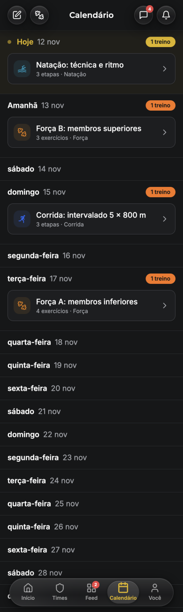
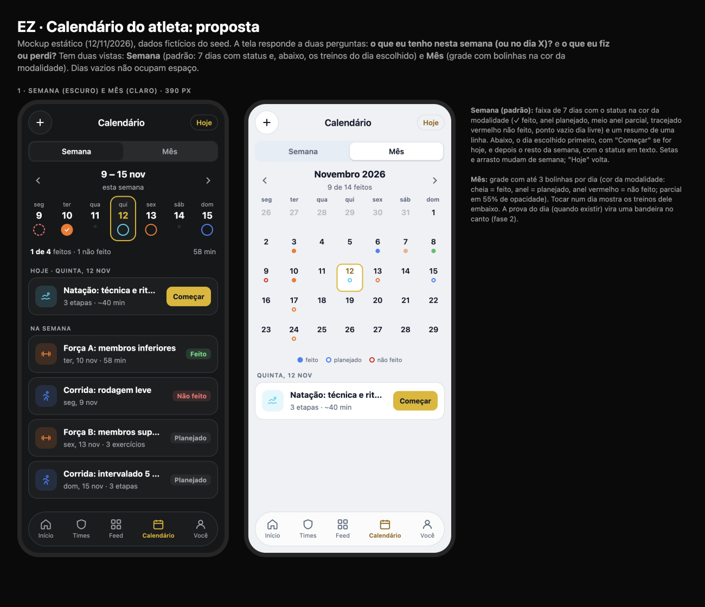

# Calendário do atleta (/athlete/calendar): diagnóstico e proposta

**Data:** 12/11/2026 · **Quem:** EZ Design · **Base:** `main` 3976698 · **Guia:** `docs/design/design-system.md` · **Linguagem:** semana da Home (`docs/design/home-athlete`) e cards do feed
**Mockup:** [`calendar-mockup.html`](calendar-mockup.html) · **Prévias:** [`img/`](img/)

**Princípio (EZ Lead, 12/11):** cada tela responde a 1–3 perguntas. Aqui são duas:
1. **O que eu tenho nesta semana (ou no dia X)?**
2. **O que eu fiz ou perdi?**

Testado no emulador em 390 px, tema escuro, com `bruno@ez.test` (fictício).

## 1. Diagnóstico

### Principais problemas
1. **É uma lista de 60 dias, não um calendário.** A janela é fixa: 7 dias para trás e 53 para frente (`CalendarView.tsx:46-47`). Não há mês nem navegação; não dá para ver outubro, nem um treino de 3 semanas atrás.
2. **Dias vazios ocupam a tela.** Mais da metade da rolagem são linhas "quarta-feira 18 nov" sem nada. Os 4 treinos da semana se perdem entre elas.
3. **Feito, pendente e não feito quase não se distinguem.** O passado mostra "100%" ou "60%" em texto pequeno à direita. "Não feito" não aparece. A pílula "1 treino" (laranja, ou amarela no dia de hoje) diz só que existe treino.
4. **O passado fica escondido.** A tela abre rolada no dia de hoje; para ver o que foi feito, é preciso rolar para cima, sem aviso de que há conteúdo lá.
5. **Ruído:** o ponto de "Hoje" pulsa sem parar; o dia da semana aparece por extenso ("segunda-feira") em todas as linhas.

## 2. Proposta

### 2.1 Vista Semana (padrão)
- Segmentado **Semana / Mês**, setas ‹ › (e arrasto) para mudar de semana, "Hoje" para voltar.
- **Faixa de 7 dias:** cada dia com o status na **cor da modalidade**:
  - ✓ cheio para feito;
  - anel para planejado;
  - meio anel para parcial;
  - tracejado vermelho para não feito;
  - ponto cinza para livre.
  - O dia escolhido tem contorno amarelo.
  - É o mesmo componente da Home (`WeekStrip`, tarefa HA-3).
- **Resumo de 1 linha:** "1 de 4 feitos · 1 não feito · 58 min".
- **Lista:** o dia escolhido primeiro (com **Começar** se for hoje e não estiver feito); depois "Na semana", só com os dias que têm treino. Cada linha mostra o ícone da modalidade, o nome, "ter, 10 nov · 58 min" e o status em texto (Feito / Parcial / Não feito / Planejado / Extra).
- **Dia sem treino:** uma linha tracejada "Dia livre · Registrar sessão extra".

### 2.2 Vista Mês
- Grade seg–dom com até 3 bolinhas por dia na cor da modalidade: cheia = feito, anel = planejado, anel vermelho = não feito, 55% de opacidade = parcial.
- Abaixo do título, "9 de 14 feitos" (só o mês).
- Tocar num dia mostra os treinos dele abaixo da grade.
- Legenda de 1 linha.
- **Fase 2:** a prova do dia aparece como uma bandeira no canto do dia. Os eventos já existem; não é dado novo.

### 2.3 O que saiu (e por quê)
| Saiu | Por quê |
|---|---|
| A lista fixa de 60 dias com uma linha por dia vazio | Não responde "o que tenho nesta semana" sem rolar. A semana e o mês respondem na primeira tela. |
| A pílula "1 treino" em cada dia | Repete a informação que o card já dá. |
| "100%" / "60%" soltos à direita | Viram o status em texto (Feito / Parcial). |
| O ponto pulsante de "Hoje" | Animação infinita sem informação (o contorno já marca o dia). |
| O dia da semana por extenso em toda linha | "ter, 10 nov" basta. |

**Dados:** tudo vem das atribuições que a tela já carrega (`scheduledDate`, `completedAt`, `completionPercentage`, `skipped`, `selfLogged`). A única mudança é **carregar por intervalo** (semana ou mês visível) em vez da janela fixa de 60 dias. Hoje a tela já busca todas as atribuições do atleta, então nem isso é obrigatório.

## 3. Backlog para o EZ Frontend (em ordem)

**⭐ = maior ganho em ~1 dia** (AC-1 + AC-2).

| ID | Tarefa | Tam. | Arquivos |
|---|---|---|---|
| ⭐ AC-1 | **Vista Semana:** `WeekStrip` (compartilhado com a Home, HA-3) + resumo + lista do dia escolhido e da semana, sem dias vazios; navegação por semana e "Hoje". | M | `src/pages/athlete/CalendarView.tsx` (reescrita do JSX, ~l. 100-236), `src/components/athlete/WeekStrip.tsx` |
| ⭐ AC-2 | **Status em texto e cores de modalidade** nas linhas (Feito, Parcial, Não feito, Planejado, Extra); remover a pílula "1 treino", o % solto e o pulso. | P | `CalendarView.tsx` |
| AC-3 | **Vista Mês:** grade com bolinhas, seleção de dia, legenda e "x de y feitos". | M | `CalendarView.tsx`, `src/components/athlete/MonthGrid.tsx` (novo) |
| AC-4 | **Dia livre** com "Registrar sessão extra" (reaproveitar `LogExtraWorkoutSheet`). | P | `CalendarView.tsx` |
| AC-5 | Fase 2: provas no mês (bandeira) e na semana (linha "Prova"). | P | `CalendarView.tsx`, `subscribeToEventsByAthlete` |
| AC-6 | QA em 375 e 390 px, claro e escuro, com semana vazia, semana cheia e mês com parcial e não feito (EZ QA). | P | testes do EZ QA |

**Ordem:** AC-1 → AC-2 (≈ 1 dia; se a HA-3 já existir, o `WeekStrip` vem pronto) → AC-3 → AC-4 → AC-5 → AC-6.

Observação: "Corrida: rodagem leve · não feito" no mockup é dado de exemplo, para mostrar o estado.
