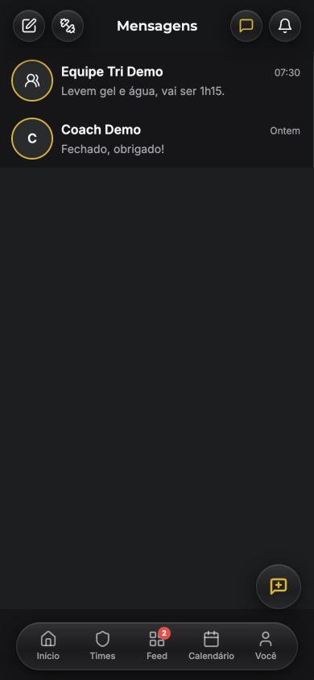
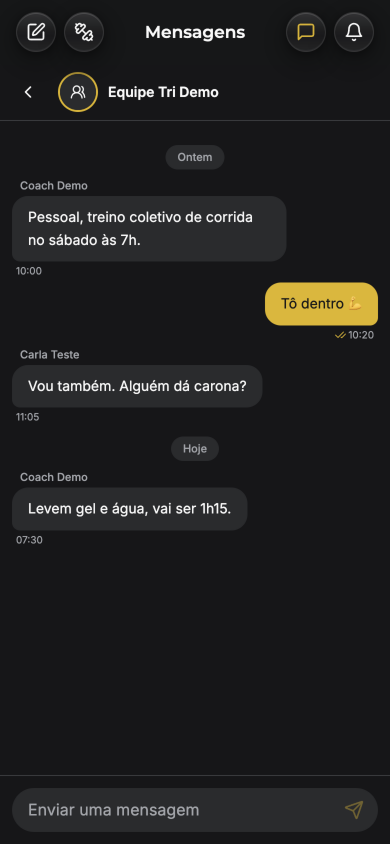
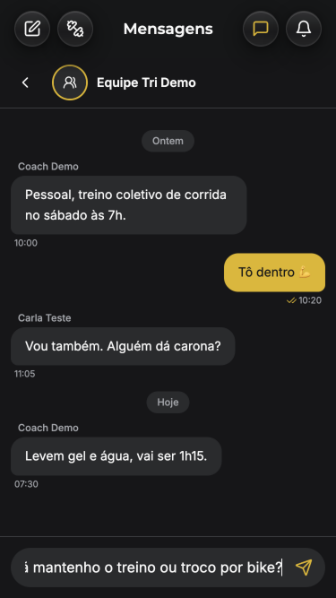
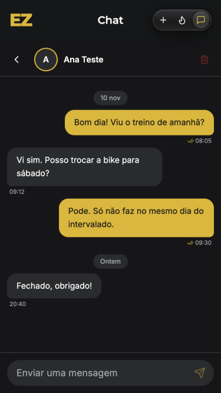
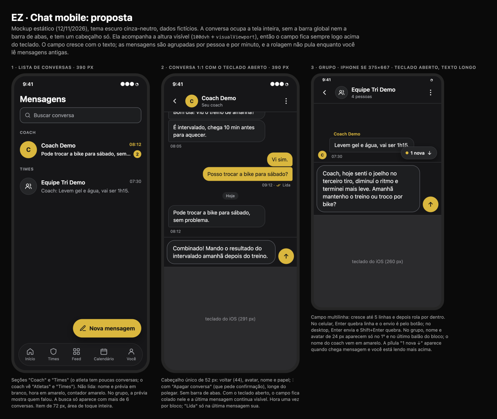
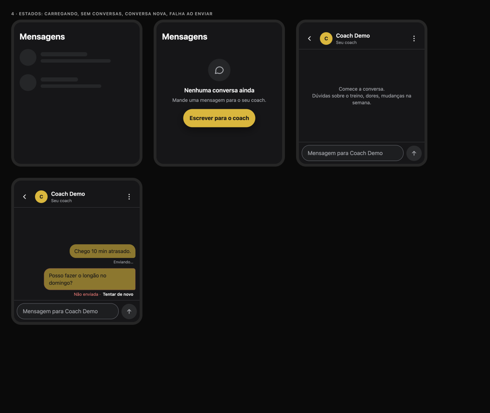

# Chat no celular: diagnóstico e proposta

**Data:** 12/11/2026 · **Quem:** EZ Design · **Base:** `main` 991c1c3 · **Guia:** `docs/design/design-system.md` (escuro cinza-neutro, §1.5)
**Pedido do usuário:** "A tela de chat no mobile está péssima em relação à usabilidade."
**Mockup:** [`chat-mockup.html`](chat-mockup.html) · **Prévias:** [`img/`](img/)

Testado no emulador: atleta (conta do time, com conversa 1:1 e grupo) e coach, em 390×844 e 375×667 (iPhone SE). Nenhuma mensagem foi enviada.
**Limite do teste:** o navegador de teste não abre o teclado do iOS. O que é sobre o teclado vem do código e do comportamento conhecido do Safari e do PWA no iOS. **Confirmar num iPhone real** (tarefa CM-10).

---

## 1. Diagnóstico

| Lista (390) | Grupo (390) | Texto longo (SE) | Coach (SE) |
|---|---|---|---|
|  |  |  |  |

### Os 5 piores problemas
1. **O teclado e a altura da tela brigam.** A conversa tem altura fixa `calc(100vh - 4rem - safe-top)` (`AthletePortalLayout.tsx:332`); o coach usa `h-screen` (`AdminLayout.tsx:208-211`). No iOS, `100vh` é a altura com a barra do Safari recolhida e **não muda quando o teclado abre**. O teclado cobre o fim da área, a página rola inteira, o cabeçalho sai da tela e a última mensagem fica atrás do teclado. Não há `dvh` nem `visualViewport` em lugar nenhum do chat. Também falta a área segura de baixo: o campo termina a 14 px da borda (medido), e no PWA instalado ele fica embaixo da barra de início do iPhone.
2. **Dois cabeçalhos dentro da conversa.** A barra global de vidro ("Mensagens" / "Chat", 64 px, com 4 botões) continua acima do cabeçalho da conversa (56 px). São **cerca de 120 px de cabeçalho**. No iPhone SE com o teclado aberto (~260 px), sobra perto de **180 px para as mensagens**, ou seja, uns 2 balões.
3. **O campo é de uma linha só** (`<input>`, `ChatWindow.tsx:168`). Uma mensagem longa corre para o lado e não dá para revisar (captura 3). Não há como quebrar linha. Há outros dois problemas aqui:
   - Se o envio falha, **o texto já foi apagado do campo** (`setDraft("")` antes do envio terminar, `ChatWindow.tsx:60`). Sai só um toast, e a mensagem se perde.
   - O botão enviar tem 40 px e é só um ícone amarelo-claro, sem fundo.
4. **A rolagem pula para o fim a cada mudança** (`useEffect` em `[messages]`, `ChatWindow.tsx:51-55`), mesmo quando a pessoa está lendo mensagens antigas. Também não há aviso "nova mensagem ↓" nem ajuste quando o teclado abre ou fecha.
5. **A conversa não tem estrutura.** Cada balão traz hora e ✓ próprios, sem agrupar por pessoa nem por minuto. Todos os balões têm a mesma "quina". No grupo, o nome aparece em cinza pequeno e não há avatar. O cabeçalho da conversa não diz quem é a pessoa (sem papel nem nº de membros) e não abre nada. No coach, o **Apagar conversa** é uma lixeira vermelha ao lado do nome (`ChatWindow.tsx:89-97`), a um toque de distância. O texto do botão de confirmar está fixo em inglês: `confirmLabel="Delete"`, `admin/Chat.tsx:418`.

### Outros pontos
| Ponto | Situação |
|---|---|
| Barra de abas dentro da conversa | ✅ some (`hideBottomNav={!!selectedChat}`) |
| Voltar | 40 px; vai para a lista (`navigate(-1)` quando veio dela) ✅. Faltam 4 px para 44. |
| Lista | Itens bons (nome, prévia, hora), mas o painel termina antes da barra de abas e deixa uma faixa de outra cor (captura 1). No grupo, a prévia não diz quem falou. Não lidas sem destaque na hora. No coach, a data está em inglês ("Yesterday") quando o idioma salvo é en; no pt, sai "Ontem". |
| Separadores de dia | ✅ "Ontem / Hoje / 10 nov". |
| Lida/enviada | ✓ e ✓✓ em toda mensagem sua, em 12 px; o ✓✓ amarelo sobre fundo escuro passa, mas é ruído. |
| Enter × quebra de linha | Enter sempre envia (é `<input>` num `<form>`); não há quebra de linha. |
| Carregando | Lista com skeleton ✅. Conversa sem estado de carregamento: fica em branco e depois "pula". |
| Vazio | Lista: "Sem conversas ativas." sem ação. Conversa nova: "Sem mensagens. Inicie uma conversa!" ✅ simples. |
| Grupo | Nome de quem falou ✅, mas sem avatar e sem cor para o coach. |
| Banner de notificações | Aparece até dentro da conversa (auditoria de 12/11, A13). |

---

## 2. Proposta

### 2.1 Layout da conversa (resolve 1 e 2)
- **Tela cheia, sem o chrome global:** a conversa aberta esconde a barra superior de vidro **e** a barra de abas. Fica um cabeçalho só, de 52 px + área segura do topo.
- **Altura = área visível de verdade:**
  - container `fixed inset-x-0 top-0` com `height: var(--app-vh, 100dvh)`;
  - um hook `useVisualViewport()` grava `--app-vh = visualViewport.height px` e acompanha `visualViewport.offsetTop` no `resize`/`scroll`;
  - assim, o teclado empurra o campo e não a página;
  - fallback: `100dvh`;
  - no `index.html`: `interactive-widget=resizes-content` no viewport (Chrome/Android).
- **Área segura:** o campo usa `padding-bottom: max(8px, env(safe-area-inset-bottom))`, mas só quando o teclado está fechado (com o teclado aberto a área segura é 0).
- **Coluna:** `[cabeçalho] [mensagens flex-1 overflow-auto overscroll-contain] [campo]`. Só a lista de mensagens rola.

### 2.2 Campo de mensagem (resolve 3)
- `<textarea rows=1>` que **cresce até 5 linhas** (`field-sizing: content` com fallback em JS) e depois rola por dentro. Fonte de 16 px (evita o zoom do iOS), raio 22, `bg-card`, borda `--input`.
- **Celular:** Enter quebra linha e o envio é pelo botão (`enterKeyHint="send"`). **Desktop (≥ md):** Enter envia e Shift+Enter quebra.
- **Botão enviar de 44 px**: círculo `bg-primary` com seta navy quando há texto; `bg-muted` quando vazio. Não tira o foco do campo, então o teclado fica aberto.
- **Envio otimista:**
  - a mensagem aparece na hora com opacidade de 60% e "Enviando…";
  - se falhar, fica "Não enviada · Tentar de novo" e o texto **nunca** se perde;
  - o rascunho fica salvo por conversa (`sessionStorage`).

### 2.3 Rolagem (resolve 4)
- Grude no fim **só** se a pessoa estiver a menos de 120 px do fim, ou se a mensagem nova for dela.
- Senão, mostre a pílula "N novas ↓" (`bg-surface-2`, ponto amarelo, 36 px) acima do campo; um toque rola para o fim.
- Ao abrir a conversa: vai para o fim **sem animação**. Quando o teclado abre: mantém a última mensagem visível.

### 2.4 Cabeçalho e mensagens (resolve 5)
- **Cabeçalho:**
  - ← de 44 px, avatar de 36 e nome em `text-title-sm`;
  - abaixo do nome, `text-caption` muted: "Seu coach" ou "Atleta"; no grupo, "N pessoas";
  - tocar no nome abre o perfil ou a lista de membros (fase 2);
  - ⋮ de 44 com "Apagar conversa" em `text-destructive-ink` e `ResponsiveConfirm` traduzido.
- **Blocos:**
  - mensagens seguidas da mesma pessoa com menos de 5 min entre elas formam um bloco;
  - 2 px entre os balões do bloco e 8 px entre blocos;
  - a hora aparece uma vez, no fim do bloco;
  - só o último balão do bloco tem a "quina" (raio de 4 px no canto do lado da pessoa).
- **Balões:**
  - os seus: `bg-primary` + `text-primary-foreground`;
  - os dos outros: `bg-card` + borda `--border`;
  - largura máxima de 78%; texto de 15 px com linha de 1,4.
- **Lida:** "✓✓ Lida" só abaixo da **última** mensagem sua; as anteriores não mostram status.
- **Grupo:**
  - nome de quem falou acima do 1º balão do bloco, e avatar de 24 px ao lado do último;
  - o nome do coach vem em `text-primary-ink`, os outros em muted.
- **Separadores de dia:** ficam como estão (pílula `bg-surface-2`).

### 2.5 Lista
- Itens de 72 px (avatar de 48) com seções "Coach" e "Times" (atleta) ou "Atletas" e "Times" (coach).
- **Não lida:** nome e prévia em `foreground` (prévia com peso 500), hora em `text-primary-ink`, contador amarelo.
- No grupo, a prévia vem com "Nome: …".
- A busca aparece com mais de 6 conversas.
- O FAB "Nova mensagem" fica com texto.
- O painel ocupa a altura até a barra de abas, sem a faixa.

### 2.6 Estados
- **Lista carregando:** o skeleton atual.
- **Conversa carregando:** 3 balões fantasma alternados.
- **Sem conversas:** `EmptyState` "Nenhuma conversa ainda / Mande uma mensagem para o seu coach." + [Escrever para o coach].
- **Conversa nova:** "Comece a conversa. Dúvidas sobre o treino, dores, mudanças na semana."
- **Falha ao enviar:** inline, no balão (2.2).

### 2.7 Originalidade
- Os padrões são os gerais de mensageiro: balões, blocos, campo que cresce.
- A identidade é do EZ: balão próprio amarelo com texto navy, balão dos outros como card com borda, coach em amarelo no grupo, cinza-neutro e o vidro só na barra global.
- Não usa as cores, os fundos com textura, os ícones nem a forma de balão de nenhum app.

---

## 3. Backlog para o EZ Frontend (em ordem)

**⭐ = "1 dia que resolve ~80%"** (CM-1 a CM-4).

| ID | Tarefa | Tam. | Arquivos |
|---|---|---|---|
| ⭐ CM-1 | **Conversa em tela cheia e altura real:** hook `useVisualViewport` (`--app-vh`); container `fixed` com `height: var(--app-vh, 100dvh)`; esconder a barra global e as abas na conversa aberta (atleta e coach); área segura embaixo; `interactive-widget=resizes-content` no viewport. | M | `src/hooks/useVisualViewport.ts` (novo), `src/components/athlete/AthletePortalLayout.tsx:185-332`, `src/components/AdminLayout.tsx:208-223`, `src/pages/athlete/Chat.tsx:214`, `src/pages/admin/Chat.tsx:278`, `index.html:6` |
| ⭐ CM-2 | **Campo novo:** `textarea` com até 5 linhas; Enter quebra no mobile e envia no desktop; botão de 44 px com fundo; foco mantido; **o rascunho só sai do campo quando o envio confirma**, e a falha devolve o texto. | P | `src/components/chat/ChatWindow.tsx:57-62, 165-186`, `src/pages/athlete/Chat.tsx:158-170`, `src/pages/admin/Chat.tsx` (handler de envio) |
| ⭐ CM-3 | **Rolagem inteligente:** grudar no fim só perto do fim ou na mensagem própria; pílula "N novas ↓"; fim sem animação ao abrir; reajuste no `visualViewport.resize`. | P | `src/components/chat/ChatWindow.tsx:51-55, 101` |
| ⭐ CM-4 | **Cabeçalho único:** ← de 44, subtítulo (papel ou nº de pessoas), ⋮ com "Apagar conversa" + confirmação traduzida (sai a lixeira solta e o "Delete" fixo). | P | `src/components/chat/ChatWindow.tsx:66-98`, `src/pages/admin/Chat.tsx:382-420`, traduções |
| CM-5 | **Blocos de mensagens:** agrupar por pessoa e 5 min, hora por bloco, quina só no último balão, "Lida" só na última sua, avatar e nome no grupo (coach em `primary-ink`). | M | `src/components/chat/ChatWindow.tsx:109-160`, `src/components/chat/chatDates.ts` |
| CM-6 | **Envio otimista com estados** (Enviando… / Não enviada · Tentar de novo) e rascunho por conversa no `sessionStorage`. | P | `ChatWindow.tsx`, `src/services/chat.ts`, `src/pages/*/Chat.tsx` |
| CM-7 | **Lista:** seções, destaque de não lidas, "Nome: …" no grupo, itens de 72 px, painel até a barra de abas, busca com mais de 6, data via `useFormat` (sai o `formatDistanceToNow` sem locale do `ChatList`). | P | `src/pages/athlete/Chat.tsx:215-300`, `src/components/chat/ChatList.tsx`, `src/pages/admin/Chat.tsx` |
| CM-8 | **Estados:** skeleton da conversa, `EmptyState` da lista com ação, textos da conversa nova. | P | `ChatWindow.tsx`, `src/pages/*/Chat.tsx`, `src/components/feedback/*` |
| CM-9 | **Banner de notificações fora da conversa** (só na Home, dispensável). | P | `src/pages/athlete/Chat.tsx`, `NotificationBanner` |
| CM-10 | **QA em aparelho real:** iPhone (Safari e PWA instalado, SE e Pro Max) e Android Chrome. Roteiro: abrir o teclado, mensagem longa, receber mensagem lendo antigas, falha de rede. Playwright: 375×667 e 390×844, com teste de "sem rolagem da página". | P | EZ QA |

**Ordem:** CM-1 → CM-2 → CM-3 → CM-4 (≈ 1 dia, resolve os 5 piores) → CM-5 → CM-6 → CM-7 → CM-8 → CM-9. CM-10 entra logo após CM-1 e de novo no fim.
