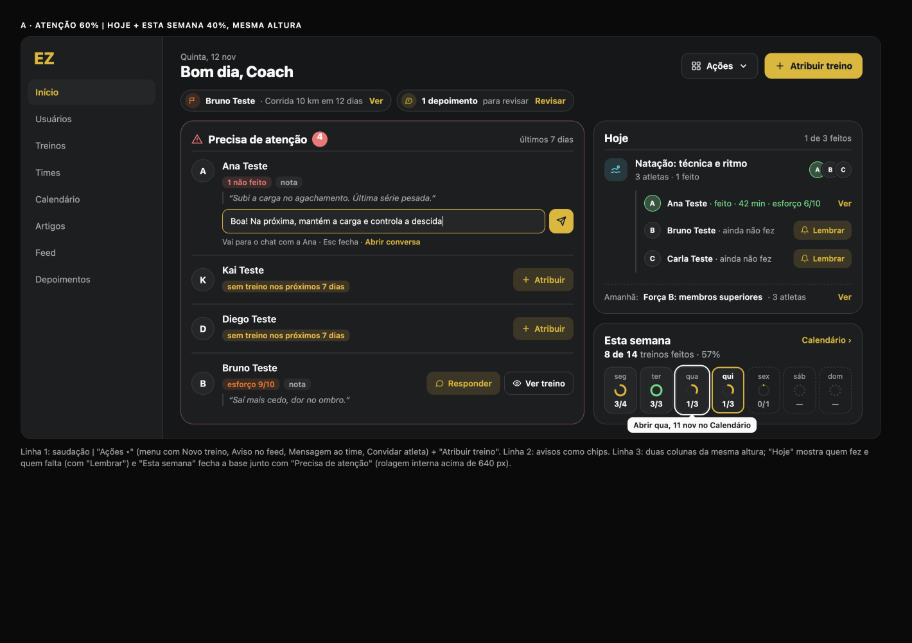
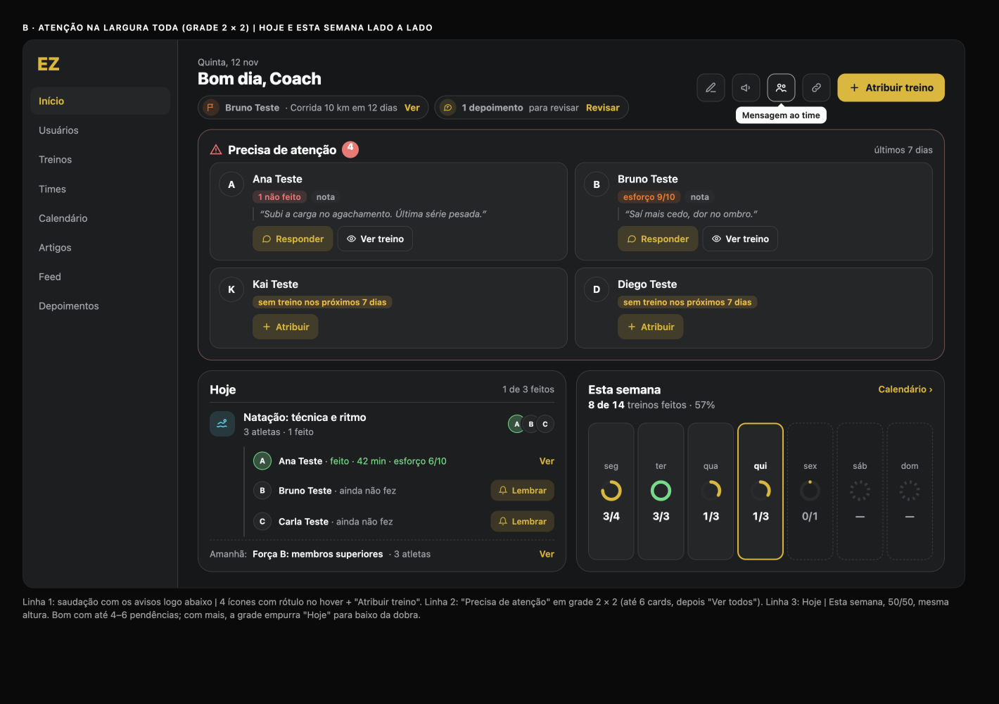

# Dashboard do coach (/admin): diagnóstico e proposta enxuta + ações rápidas

**Data:** 12/11/2026 · **Quem:** EZ Design · **Base:** `main` 44563a3 · **Guia:** `docs/design/design-system.md` · **Linguagem:** cards do feed e da tela "Você" (`docs/design/profile`)
**Mockup:** [`dashboard-mockup.html`](dashboard-mockup.html) · **Prévias:** [`img/`](img/)

**Perguntas que a tela responde (princípio do EZ Lead), em ordem:**
1. **Quem precisa de mim?** O bloco principal, com as ações.
2. **O que acontece hoje?** Os treinos agrupados, com amanhã numa linha.
3. **Como vai a semana?** Um card pequeno: "8 de 14 treinos feitos · 57%" e feitos/planejados por dia.

**Meta:** cabe numa tela em 1440 × 900; no celular, ~1,5 tela com 4 pendências e 2 avisos.

**Ajuste de 12/11 (pedido do usuário: "mais algumas infos de ação rápida para o coach"):** os 3 blocos ficam; entram **ações, nenhum número a mais**. Nada novo no Firestore. Cada ação está marcada como **reaproveita** (o fluxo já existe e só ganha um atalho) ou **novo** (código novo de UI, sem dado novo).

Testado no emulador como `coach@ez.test`, em 1440 px e 390 px, tema escuro. Dados do mockup: fictícios, do seed.

## 1. Diagnóstico

| Desktop | Celular |
|---|---|
|  |  |

### Principais problemas
1. **"Precisa de atenção" está escondido.**
   - No desktop, fica na coluna lateral.
   - No celular, só aparece depois de ~1.200 px.
   - Não tem ação: para responder a uma nota, o coach precisa achar o atleta no chat.
2. **Os números de cima são inventário** ("6 Atletas · 1 Time · 5 Treinos") e quase não mudam. Cada um tem uma cor própria, fora da paleta.
3. **Repetição:**
   - "Amanhã" e "Atividade de hoje" listam o mesmo treino uma vez por atleta;
   - a faixa de datas repete o Calendário;
   - "Destaques da semana" repete a tabela;
   - "Conclusão geral" e "Tendência" contam a mesma história.
4. **A tabela de atletas é pesada e corta nomes** ("Carl…"). Ela também já existe em Usuários.
5. **O gráfico de tendência fica ilegível** (auditoria C7).

## 2. Proposta enxuta

**Ordem:** cabeçalho (saudação, "Ações", "Atribuir treino") → **chips de aviso**, só quando existem → **precisa de atenção** → **hoje** (+ linha de amanhã) → **esta semana**.

### Layout (ajuste de 12/11: "ainda não está bem distribuído")
Conteúdo igual ao aprovado; muda só a distribuição. Regras para as duas variações: **mesmo gap (14 px) e mesmo raio (20 px)** em todos os cards, topos e bases alinhados, **"Atribuir treino" como único botão primário**, e avisos como **chips numa linha** que somem quando não há aviso.

| A · grade proposta (**recomendada**) | B · alternativa |
|---|---|
|  |  |

- **A:** linha 1, saudação | "Ações ▾" (menu: Novo treino, Aviso no feed, Mensagem ao time, Convidar atleta) + "Atribuir treino". Linha 2, chips de aviso. Linha 3, duas colunas da **mesma altura**: "Precisa de atenção" (60%, rolagem interna acima de 640 px) | "Hoje" em cima e "Esta semana" embaixo (40%). Para "Hoje" não sobrar vazio, ele mostra **quem fez e quem falta** do treino do dia, com "Lembrar" por atleta (o mesmo conteúdo da folha "Ver resultados", agora inline no desktop).
- **B:** saudação com os chips de aviso logo abaixo | 4 ícones com rótulo no hover + "Atribuir treino". "Precisa de atenção" na largura toda, em grade 2 × 2 (até 6 cards, depois "Ver todos"). Embaixo, Hoje | Esta semana, 50/50, mesma altura.
- **Por que A:** aguenta listas longas de atenção (rolagem interna) sem empurrar "Hoje" para baixo da dobra, e "Precisa de atenção" continua o 1º bloco lido. B fica bonita com 4 pendências, mas com 8 a grade ocupa a tela toda.
- **Celular** (as duas variações): chips de aviso → Precisa de atenção → Hoje → Esta semana; **"Atribuir" fixo** (botão flutuante) e o resto no botão **"Ações"** do topo, que abre uma folha.

### 2.0 Ações rápidas
- **Desktop:** "Atribuir treino" (primário) + as outras 4 num menu "Ações ▾" (A) ou em ícones com rótulo no hover (B). Nada de 5 botões grandes.
- **Celular:** "Atribuir" fixo como botão flutuante; as outras 4 na folha "Ações" (botão no topo).

| Ação | O que faz | Status | Onde já existe |
|---|---|---|---|
| Atribuir treino | Abre o modal de atribuição | reaproveita | `assignDialogOpen` em `Dashboard.tsx` |
| Novo treino | Menu com a modalidade → editor | reaproveita | `/admin/workouts/new?type=running\|cycling\|swimming`, `/admin/workouts/strength/new` |
| Aviso no feed | Abre o composer do feed | reaproveita | `useTimelineActions().setCreateOpen(true)` + `CreatePostModal` (no `AdminLayout`). É um post normal: **não existe tipo "aviso" nem fixar no topo** (isso exigiria dado novo; fica de fora). |
| Mensagem ao time | Abre o chat do grupo do time | reaproveita | `ChatService.createOrGetGroupChat(team…)` + `/admin/chat` com `state.openChatId` |
| Convidar atleta | Copia o link de convite; toast "Link de convite do time copiado" | reaproveita | `team.inviteToken` → `/join/:inviteToken`; a cópia já existe em `TeamDetail.tsx:109-114` |

- Com **mais de um time**, "Mensagem ao time" e "Convidar atleta" abrem um menu para escolher o time; com um time só, a ação é direta.

### 2.1 Esta semana (card compacto)
**Ajuste de 12/11:** o usuário achou a faixa de 7 barras "estranha, toda esticada" e não entendeu para que servia. **A faixa saiu.** Nada de barras na largura toda.

- **Onde:** desktop, na coluna da direita, logo abaixo de "Hoje"; celular, abaixo de "Hoje". O topo fica só com saudação, ações e atenção.
- **Título** "Esta semana" + link "Calendário ›"; **linha** "**8 de 14** treinos feitos · 57%" (só a semana atual, seg–dom).
- **7 dias compactos** (células de ~54 px): dia, um **anel pequeno** de progresso e **"feitos/planejados"** ("3/4").
  - Anel verde quando o dia fechou completo; amarelo quando parcial.
  - **Hoje** com borda `primary`.
  - Dias futuros tracejados, com o planejado ("0/1"); dia sem treino, "—".
- **Tocar num dia abre o Calendário do coach nesse dia** (dica no hover: "Abrir qua, 11 nov no Calendário"). **Novo (pequeno):** `/admin/calendar` hoje não lê data da URL; precisa aceitar `?date=AAAA-MM-DD` e chamar `setSelectedDate`/`setCurrentMonth`, que já existem.
- **Dados:** vêm das atribuições já carregadas (`completedAt`, `scheduledDate`). **Nada novo.**
- **Recomendo o card**, não só a linha de texto: o "1/3" de quarta mostra **em que dia** a semana falhou e leva direto ao Calendário para remarcar, o que a linha sozinha não faz. **Alternativa mínima**, se o card ainda parecer demais: só a linha "8 de 14 treinos feitos · 57% · Ver no Calendário ›" no fim do card "Hoje".

### 2.2 Precisa de atenção (bloco principal)
- Desktop: a coluna da esquerda, a mais larga, com borda `destructive/35`. Celular: logo abaixo das ações rápidas.
- Cada atleta tem avatar, nome e **chips com os motivos que o código já calcula** (`attention`, `Dashboard.tsx:176-212`):

| Motivo | Chip | Ações |
|---|---|---|
| `overdue` | "N atrasado(s)", `destructive-ink` | Responder · Ver treino |
| `skipped` | "N não feito(s)", `destructive-ink` | Responder · Ver treino |
| `highEffort` | "esforço 9/10", `--sport-strength` | Responder · Ver treino |
| `note` | "nota" + citação em itálico (1 linha) | Responder · Ver treino |
| `noPlan` | "sem treino nos próximos 7 dias", `warning-ink` | Atribuir |

- **Ações:**
  - **Responder** (**novo**) abre uma **resposta rápida no próprio card**: campo de 1 linha + enviar. Envia no chat do atleta (`ChatService.createOrGetChat` + `sendMessage`, que já existem), fecha o campo e mostra "Enviado · Abrir conversa". Esc ou tocar fora fecha sem enviar; o texto fica como rascunho do chat (`ez-chat-draft-v1:<chatId>`, já existe).
  - **Ver treino** abre a atividade (o `assignmentId` já vem no motivo).
  - **Atribuir** abre o modal com o atleta já escolhido.
- **Ordem:** pelo peso que já existe (overdue 3, skipped 2, highEffort 2, noPlan 2, note 1).
- **Vazio:** uma linha verde, "✓ Todos em dia nos últimos 7 dias".
- "Sem treino nos próximos 7 dias" **continua**, como o usuário pediu.
- **"Marcar como visto" ficou de fora:** não existe campo de "visto" nas atribuições, e guardar só no navegador faria o atleta voltar em outro aparelho. Exige dado novo (um `dismissedAt` por motivo).

### 2.3 Hoje
- **Agrupado por treino:** "Natação: técnica e ritmo · 3 atletas · 1 feito", com o ícone da modalidade e os avatares empilhados. Tocar abre a lista de atletas.
- No título do card: "1 de 3 feitos".
- **Ações por treino (novo, sem dado novo):**
  - **Ver resultados** abre uma folha (celular) ou popover (desktop) com cada atleta: feito ou não, duração, esforço (`rpe`) e nota (`athleteNotes`), e "Ver" para a atividade (`/admin/athletes/:athleteId/activity/:id`, já existe).
  - **Lembrar quem falta (N)** aparece só quando falta alguém. Abre a mesma folha com "Lembrar" por atleta: abre o chat dele com o **texto pronto no campo** ("Oi, Bruno! Hoje tem Natação: técnica e ritmo. Conseguiu encaixar? Se precisar ajustar, me avisa."). **Nada é enviado sozinho**; o coach revisa e envia. Como: grava o rascunho em `ez-chat-draft-v1:<chatId>` e navega com `state.openChatId`. Lembrete individual, não no grupo, para não expor quem não treinou.
- **Amanhã** é **uma linha** no fim do card: "Amanhã: Força B · 3 atletas · Ver".
- **Sem treino hoje:** "Nenhum treino hoje", e a linha de amanhã continua.

### 2.4 Avisos condicionais (chips numa linha, só quando existem)
- **Prova em menos de 14 dias:** "Bruno Teste · Corrida 10 km em 12 dias · Ver".
- **Depoimento pendente:** "1 depoimento para revisar · Revisar".
- Quando não há nenhum, nada aparece. Não há estado vazio nem título de seção.

### 2.5 O que saiu (e por quê)
| Saiu | Por quê |
|---|---|
| 3 dos 4 números (treinos feitos, atletas que treinaram, horas do time) e os cards de inventário | Não levam a uma decisão. "8 de 14 · 57%" e a lista de atenção já dizem se a semana vai bem e quem está fora. |
| "Conclusão geral 79%" com treinos antigos | Misturava períodos; agora só conta a semana atual. |
| Gráfico de tendência de 8 semanas | Ilegível (C7) e não leva a uma ação hoje. O card "Esta semana" responde "como vai a semana". |
| Faixa de 7 barras esticada na largura toda (versão f2624bc) | Pouco clara para o coach ("não sei pra que serve"); virou o card compacto com "3/4" por dia. |
| Tabela "Atletas nesta semana" e "Destaques da semana" | Já existem em Usuários; quem precisa de ação aparece em "Precisa de atenção". |
| Bloco "Amanhã" | Virou uma linha no fim de "Hoje". |
| Faixa de datas e "Atividade de hoje" | A faixa repete o Calendário; a atividade de hoje entrou em "Hoje", agrupada. |
| "Próximas provas" fixo | Só vira aviso quando há prova em menos de 14 dias. |
| "Status dos depoimentos" | Só vira aviso quando há depoimento pendente. |
| "Atividade recente" e "Times" | Já estão no Feed e no menu. |

### 2.6 Dados e decisões
- **Nada novo** no Firestore para esta versão.
- Fica para depois: "marcar como visto" para tirar alguém da lista de atenção. **⛔ Precisa de dado novo** (um `dismissedAt` por motivo).

## 3. Backlog para o EZ Frontend (em ordem)

**⭐ = maior ganho em ~1 dia** (CD-1 a CD-4).

| ID | Tarefa | Tam. | Arquivos |
|---|---|---|---|
| ⭐ CD-1 | **Precisa de atenção como bloco principal:** coluna principal no desktop e 2º bloco no celular; chips por motivo; **resposta rápida no card** (campo + enviar no chat); Ver treino; Atribuir; estado vazio. | M | `src/pages/admin/Dashboard.tsx` (bloco `attention`, ~l. 176-215, e o JSX), `src/components/admin/AttentionList.tsx` (novo), `src/services/chat.ts` (só uso) |
| ⭐ CD-2 | **Card "Esta semana"** abaixo de "Hoje": "x de y treinos feitos · %" só da semana atual + 7 dias compactos (anel + "feitos/planejados", hoje destacado, futuros tracejados); **tocar no dia abre `/admin/calendar?date=`** (Calendar passa a ler `date`). Hook `useTeamWeekStats(assignments)` com contagem por dia, com teste. | P | `Dashboard.tsx`, `src/components/admin/WeekCard.tsx` (novo), `src/hooks/useTeamWeekStats.ts` (novo), `src/pages/admin/Calendar.tsx` |
| ⭐ CD-3 | **Layout e ações rápidas:** grade A (atenção 60% com rolagem interna | Hoje + Esta semana 40%, mesma altura; gap 14, raio 20); "Atribuir treino" + menu "Ações" (Novo treino, Aviso no feed, Mensagem ao time, Convidar atleta); no celular, "Atribuir" flutuante e folha "Ações". | P | `Dashboard.tsx`, `src/components/admin/QuickActions.tsx` (novo, `DropdownMenu`/`Sheet` do shadcn) |
| ⭐ CD-4 | **Remover o que saiu:** cards de inventário, "Conclusão geral", tendência (`LineChart`), tabela de atletas, "Destaques", faixa de datas, "Atividade de hoje", "Atividade recente", "Times", bloco "Amanhã". | P | `Dashboard.tsx` (~l. 400-760) |
| CD-5 | **Hoje agrupado por treino** + linha "Amanhã" + **Ver resultados / Lembrar quem falta** (folha com rpe e nota; "Lembrar" abre o chat com o texto no campo, sem envio automático). | M | `Dashboard.tsx`, `src/components/admin/TodayWorkoutSheet.tsx` (novo), `src/components/chat/ChatWindow.tsx` (rascunho já existe) |
| CD-6 | **Avisos condicionais** como chips numa linha (prova em menos de 14 dias, depoimento pendente), que some quando não há aviso; "quem fez / quem falta" inline em "Hoje" no desktop. | P | `Dashboard.tsx` |
| CD-7 | QA: 1440 × 900 sem rolar; 390 px em ~1,4 tela com 4 pendências e 2 avisos; claro e escuro; com 0 pendências, 0 treinos hoje, 0 avisos, 1 e 2 times; resposta rápida (enviar, Esc, erro de rede); lembrete não envia sozinho (EZ QA). | P | testes do EZ QA |

**Ordem:** CD-1 → CD-2 → CD-3 → CD-4 (≈ 1 dia) → CD-5 → CD-6 → CD-7.

**Fora (exige dado novo):** "Marcar como visto" (`dismissedAt` por motivo) e aviso fixado no feed (tipo/pin no post).

O backlog anterior (cartão com 4 números, tabela de atletas, sparkline de 8 semanas) foi **substituído** por este.
