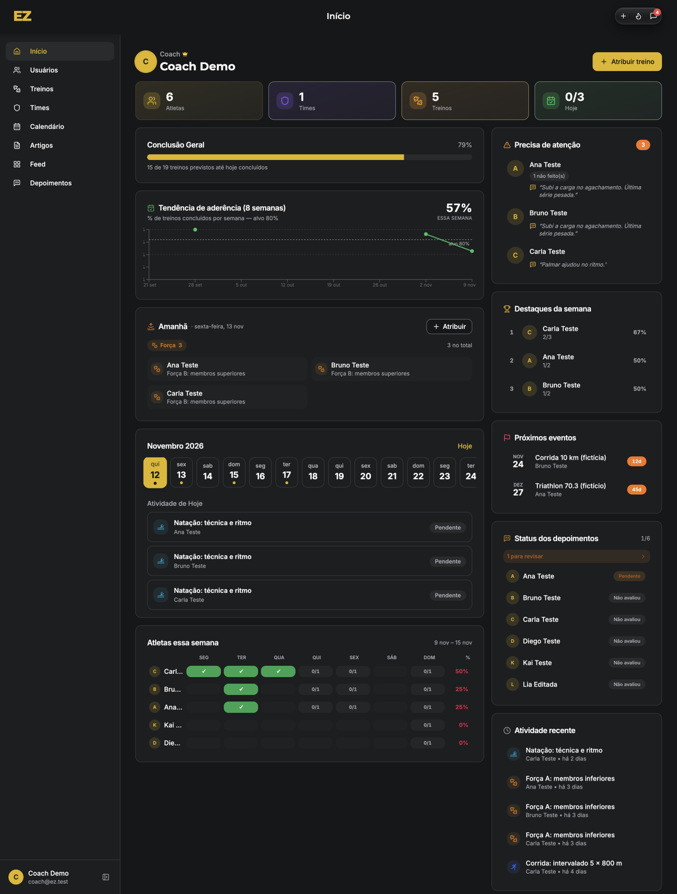
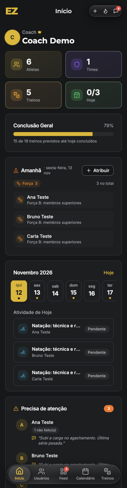
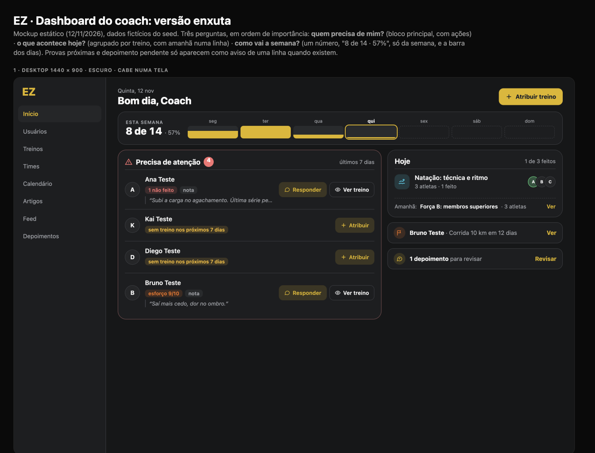
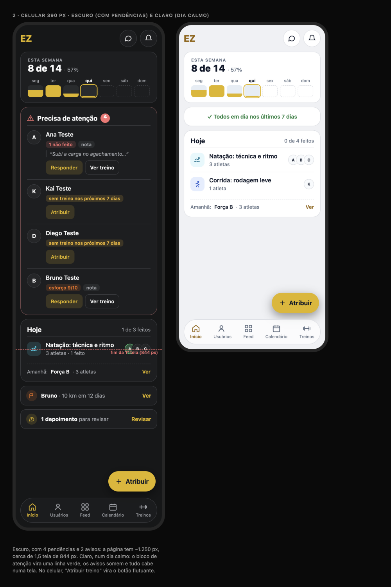

# Dashboard do coach (/admin): diagnóstico e proposta enxuta

**Data:** 12/11/2026 · **Quem:** EZ Design · **Base:** `main` 44563a3 · **Guia:** `docs/design/design-system.md` · **Linguagem:** cards do feed e da tela "Você" (`docs/design/profile`)
**Mockup:** [`dashboard-mockup.html`](dashboard-mockup.html) · **Prévias:** [`img/`](img/)

**Perguntas que a tela responde (princípio do EZ Lead), em ordem:**
1. **Quem precisa de mim?** O bloco principal, com as ações.
2. **O que acontece hoje?** Os treinos agrupados, com amanhã numa linha.
3. **Como vai a semana?** Um número e a barra dos dias.

**Meta:** cabe numa tela em 1440 × 900; no celular, cerca de 1,5 tela com pendências e 1 tela num dia calmo.

Testado no emulador como `coach@ez.test`, em 1440 px e 390 px, tema escuro. Dados do mockup: fictícios, do seed.

## 1. Diagnóstico

| Desktop | Celular |
|---|---|
|  |  |

### Principais problemas
1. **"Precisa de atenção" está escondido.**
   - No desktop, fica na coluna lateral.
   - No celular, só aparece depois de ~1.200 px.
   - Não tem ação: para responder a uma nota, o coach precisa achar o atleta no chat.
2. **Os números de cima são inventário** ("6 Atletas · 1 Time · 5 Treinos") e quase não mudam. Cada um tem uma cor própria, fora da paleta.
3. **Repetição:**
   - "Amanhã" e "Atividade de hoje" listam o mesmo treino uma vez por atleta;
   - a faixa de datas repete o Calendário;
   - "Destaques da semana" repete a tabela;
   - "Conclusão geral" e "Tendência" contam a mesma história.
4. **A tabela de atletas é pesada e corta nomes** ("Carl…"). Ela também já existe em Usuários.
5. **O gráfico de tendência fica ilegível** (auditoria C7).

## 2. Proposta enxuta

**Ordem:** cabeçalho (data, saudação, "Atribuir treino") → **semana numa linha** → **precisa de atenção** (desktop: coluna principal) → **hoje** (+ linha de amanhã) → avisos, só quando existem.

### 2.1 Semana numa linha
- **Um número só:** "8 de 14 · 57%", com os treinos feitos sobre os previstos **da semana atual** (seg–dom), sem os antigos.
- **Barra por dia:** 7 colunas com a altura igual à % feita; hoje tem contorno e os dias futuros ficam tracejados.
- **Dados:** vêm das atribuições já carregadas (`completedAt`, `scheduledDate`). **Nada novo.**

### 2.2 Precisa de atenção (bloco principal)
- Desktop: a coluna da esquerda, a mais larga, com borda `destructive/35`. Celular: logo abaixo da semana.
- Cada atleta tem avatar, nome e **chips com os motivos que o código já calcula** (`attention`, `Dashboard.tsx:176-212`):

| Motivo | Chip | Ações |
|---|---|---|
| `overdue` | "N atrasado(s)", `destructive-ink` | Responder · Ver treino |
| `skipped` | "N não feito(s)", `destructive-ink` | Responder · Ver treino |
| `highEffort` | "esforço 9/10", `--sport-strength` | Responder · Ver treino |
| `note` | "nota" + citação em itálico (1 linha) | Responder · Ver treino |
| `noPlan` | "sem treino nos próximos 7 dias", `warning-ink` | Atribuir |

- **Ações:**
  - **Responder** abre o chat com o atleta.
  - **Ver treino** abre a atividade (o `assignmentId` já vem no motivo).
  - **Atribuir** abre o modal com o atleta já escolhido.
- **Ordem:** pelo peso que já existe (overdue 3, skipped 2, highEffort 2, noPlan 2, note 1).
- **Vazio:** uma linha verde, "✓ Todos em dia nos últimos 7 dias".
- "Sem treino nos próximos 7 dias" **continua**, como o usuário pediu.

### 2.3 Hoje
- **Agrupado por treino:** "Natação: técnica e ritmo · 3 atletas · 1 feito", com o ícone da modalidade e os avatares empilhados. Tocar abre a lista de atletas.
- No título do card: "1 de 3 feitos".
- **Amanhã** é **uma linha** no fim do card: "Amanhã: Força B · 3 atletas · Ver".
- **Sem treino hoje:** "Nenhum treino hoje", e a linha de amanhã continua.

### 2.4 Avisos condicionais (1 linha cada, só quando existem)
- **Prova em menos de 14 dias:** "Bruno Teste · Corrida 10 km em 12 dias · Ver".
- **Depoimento pendente:** "1 depoimento para revisar · Revisar".
- Quando não há nenhum, nada aparece. Não há estado vazio nem título de seção.

### 2.5 O que saiu (e por quê)
| Saiu | Por quê |
|---|---|
| 3 dos 4 números (treinos feitos, atletas que treinaram, horas do time) e os cards de inventário | Não levam a uma decisão. "8 de 14 · 57%" e a lista de atenção já dizem se a semana vai bem e quem está fora. |
| "Conclusão geral 79%" com treinos antigos | Misturava períodos; agora só conta a semana atual. |
| Gráfico de tendência de 8 semanas | Ilegível (C7) e não leva a uma ação hoje. A barra dos dias responde "como vai a semana". |
| Tabela "Atletas nesta semana" e "Destaques da semana" | Já existem em Usuários; quem precisa de ação aparece em "Precisa de atenção". |
| Bloco "Amanhã" | Virou uma linha no fim de "Hoje". |
| Faixa de datas e "Atividade de hoje" | A faixa repete o Calendário; a atividade de hoje entrou em "Hoje", agrupada. |
| "Próximas provas" fixo | Só vira aviso quando há prova em menos de 14 dias. |
| "Status dos depoimentos" | Só vira aviso quando há depoimento pendente. |
| "Atividade recente" e "Times" | Já estão no Feed e no menu. |

### 2.6 Dados e decisões
- **Nada novo** no Firestore para esta versão.
- Fica para depois: "marcar como visto" para tirar alguém da lista de atenção. **⛔ Precisa de dado novo** (um `dismissedAt` por motivo).

## 3. Backlog para o EZ Frontend (em ordem)

**⭐ = maior ganho em ~1 dia** (CD-1 a CD-3).

| ID | Tarefa | Tam. | Arquivos |
|---|---|---|---|
| ⭐ CD-1 | **Precisa de atenção como bloco principal:** coluna principal no desktop e 2º bloco no celular; chips por motivo; Responder / Ver treino / Atribuir; estado vazio. | M | `src/pages/admin/Dashboard.tsx` (bloco `attention`, ~l. 176-215, e o JSX), `src/components/admin/AttentionList.tsx` (novo) |
| ⭐ CD-2 | **Semana numa linha:** "x de y · %" só da semana atual + barra por dia. Hook `useTeamWeekStats(assignments)`, com teste. | P | `Dashboard.tsx`, `src/hooks/useTeamWeekStats.ts` (novo) |
| ⭐ CD-3 | **Remover o que saiu:** cards de inventário, "Conclusão geral", tendência (`LineChart`), tabela de atletas, "Destaques", faixa de datas, "Atividade de hoje", "Atividade recente", "Times", bloco "Amanhã". | P | `Dashboard.tsx` (~l. 400-760) |
| CD-4 | **Hoje agrupado por treino** + linha "Amanhã" no fim do card. | P | `Dashboard.tsx` |
| CD-5 | **Avisos condicionais:** prova em menos de 14 dias e depoimento pendente, uma linha cada, nada quando não existem. | P | `Dashboard.tsx` |
| CD-6 | QA: 1440 × 900 sem rolar; 390 px em ~1,5 tela com 4 pendências e 2 avisos; claro e escuro; com 0 pendências, 0 treinos hoje e 0 avisos (EZ QA). | P | testes do EZ QA |

**Ordem:** CD-1 → CD-2 → CD-3 (≈ 1 dia) → CD-4 → CD-5 → CD-6.

O backlog anterior (cartão com 4 números, tabela de atletas, sparkline de 8 semanas) foi **substituído** por este.
