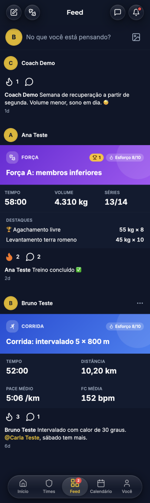
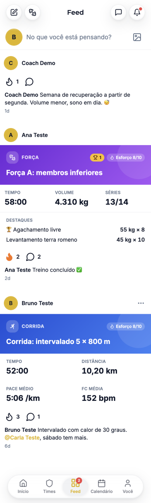
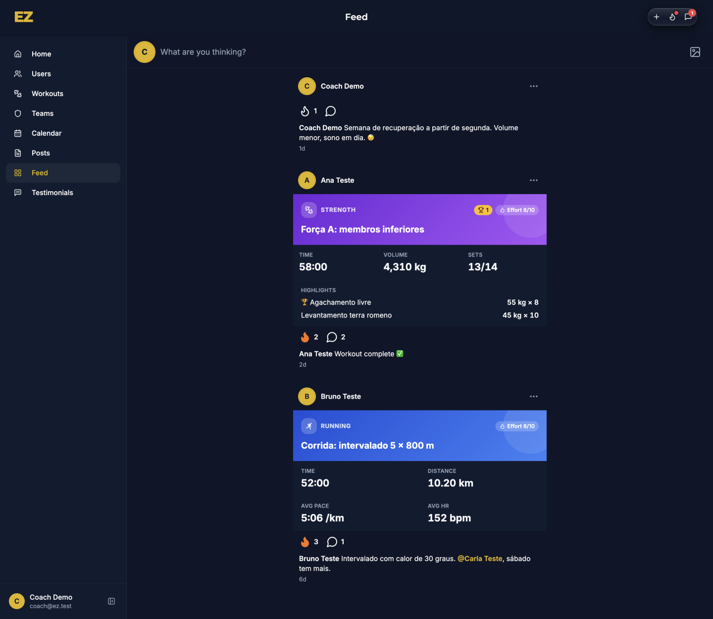
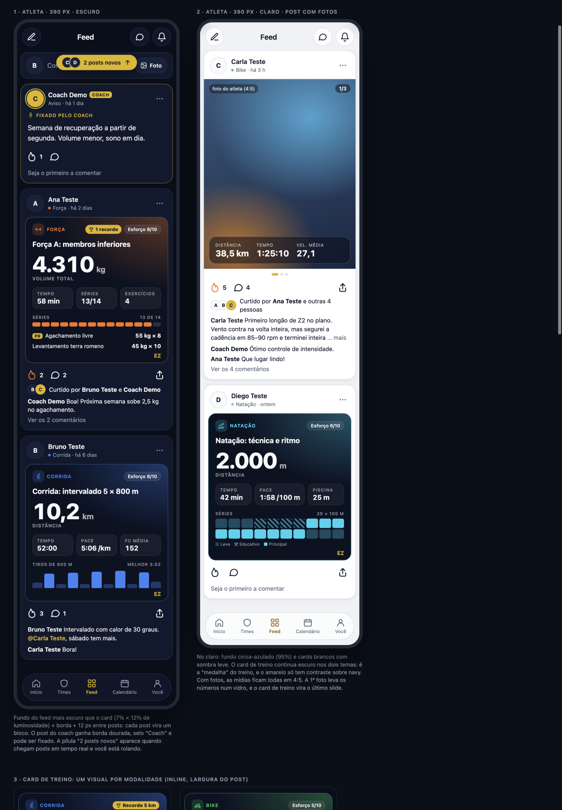
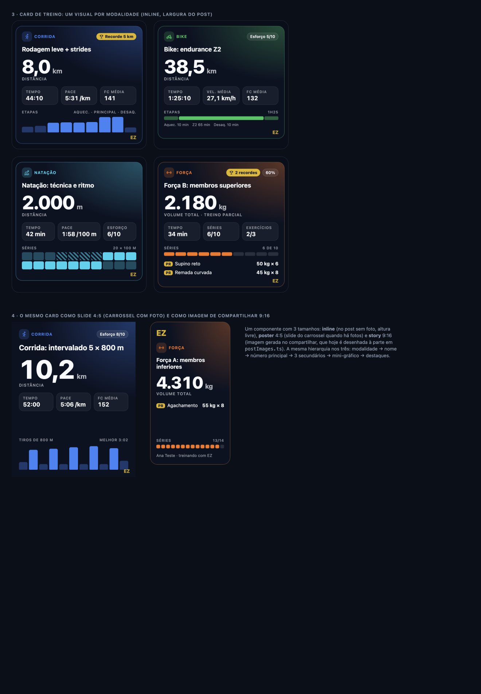
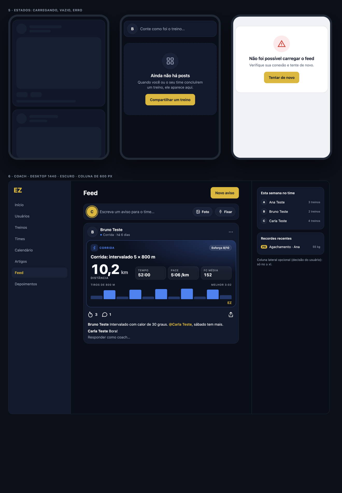

# Feed: diagnóstico e proposta de redesenho

**Data:** 12/11/2026 · **Quem:** EZ Design · **Base:** `main` 286a7af · **Guia:** `docs/design/design-system.md`
**Mockups:** [`feed-mockup.html`](feed-mockup.html) (HTML estático; abra no navegador) e as prévias em [`img/`](img/).
**Status:** proposta para o usuário aprovar. Nada de código do app foi alterado.

Pedido do usuário: o feed precisa parecer muito bonito, no nível de um app social de primeira linha; hoje os posts não têm separação clara entre si, e os cards padrão de cada exercício poderiam ser mais bonitos.

---

## 1. Diagnóstico (estado atual)

Visto no emulador: atleta em 390 px (escuro e claro) e coach em 1440 px.

| Atleta · escuro | Atleta · claro | Coach · desktop |
|---|---|---|
|  |  |  |

### Por que os posts se misturam
1. **Sem superfície própria.** O `<article>` não tem fundo, borda nem raio (`TimelinePostCard.tsx:132`): cabeçalho, ações e legenda ficam direto sobre o fundo da página. Só o bloco de números do card de treino usa `bg-card`, e no escuro `card` (13%) e `background` (11%) quase não se distinguem. **No claro, tudo é branco sobre branco.**
2. **Espaço que não separa.** Os posts ficam a só 20 px uns dos outros (`TimelineFeed.tsx`, `space-y-5`), e o cabeçalho de um post começa logo abaixo do "2d" do anterior. O olho lê "data do post A + nome do post B" como um bloco só.
3. **Cabeçalho fraco.** Só avatar de 32 px + nome. Não há tempo (ele fica no rodapé, em 12 px), nem modalidade, nem papel. O post do coach parece igual ao de qualquer atleta. Todo avatar tem o mesmo anel amarelo, então o anel não significa nada.
4. **Ordem quebrada no post só texto.** No post do coach, as ações (🔥 1, 💬) vêm **antes** do texto: o texto parece uma legenda solta, e as ações, órfãs.
5. **Legenda redundante.** O texto automático "Treino concluído ✅" repete o card logo acima.
6. **Desktop:** o compositor ocupa a largura toda, mas a coluna do feed tem 512 px; o card fica com cantos retos, colado nas bordas da coluna.

### Por que o card de treino parece "padrão"
1. **Sem hierarquia de números.** São 3–4 métricas do mesmo tamanho (20 px) numa grade com rótulos em caixa alta. Nenhum número "conta a história" do treino.
2. **Faixa de gradiente genérica.** Uma faixa saturada (força em roxo, fora da paleta e diferente do laranja usado no resto do app) com um círculo decorativo. A identidade EZ (navy + amarelo) quase some.
3. **Nada visual.** Não há gráfico nem forma, só números. Os dados para isso já existem no resumo (etapas e repetições em `stageTimes`, séries feitas em `workingSets/totalSets`) e não são usados.
4. **"—" para dado ausente** ocupa uma célula inteira (`cardStats`), e o card fica com cara de formulário.
5. **Emoji 🏆** como selo de recorde, e o mesmo ícone (`Flame`) para "esforço" e para "curtir".
6. **Três desenhos diferentes** para o mesmo treino: o card do feed, o overlay da foto e a imagem de Stories (`postImages.ts`).

### O que falta no seed para validar
Hoje há **3 posts**: força, corrida e um aviso do coach só com texto. Para revisar a implementação, pedir ao EZ QA:
- 1 post de **bike** e 1 de **natação** (com `stageTimes`);
- 2 posts **com foto** (1 foto; 3 fotos + card de treino);
- 1 **legenda longa** (> 140 caracteres) com menção;
- 1 post com **6+ comentários** e respostas;
- 1 treino **parcial** com recorde;
- 1 post de atleta **sem curtidas nem comentários**;
- posts mais antigos que **7 dias**, para testar a data relativa e a paginação.

---

## 2. Proposta

### 2.1 Post
| Parte | Decisão | Tokens e valores |
|---|---|---|
| **Separação** | Cada post vira um card sobre um fundo próprio do feed, mais escuro. | Novo `--feed-canvas`: escuro `222 47% 7%`, claro `220 20% 95%`. Post: `bg-card rounded-2xl border` (`e1`); no claro, `shadow-sm`. Mobile `mx-2`; **12 px** entre posts (`space-y-3`); desktop: coluna de **600 px**, 16 px entre posts. |
| **Cabeçalho** | Avatar de 40, nome em `text-title-sm`, e numa 2ª linha `•` na cor da modalidade + "Corrida · há 6 dias" (`text-caption`, muted). ⋮ de 44 px. | Data via `useFormat().relative` (sai o "1d/2d"). O anel amarelo fica só no avatar do coach. |
| **Coach** | Selo `Coach` (`text-overline`, `bg-primary`), borda `primary/45`, avatar amarelo com anel. Opcional: **fixar** um aviso no topo. | Fixar precisa de campo novo (`pinned`) 🔧 e da decisão D3. |
| **Post só texto** | Texto em `text-body` (16 px), **antes** das ações. | — |
| **Mídia** | Proporção **fixa 4:5** (`aspect-[4/5]`, `object-cover`) para todas as fotos; carrossel com contador "1/3" no canto e pontos abaixo (o ponto ativo é uma pílula amarela). Com fotos + treino: a 1ª foto leva os 3 números num **vidro** (`.glass`) e o card de treino vira o **último** slide, em 4:5. | Hoje a proporção varia de 4:5 a 1,91:1. A proporção fixa evita saltos no scroll. |
| **Ações** | Curtir (chama), comentar, compartilhar (à direita). Alvos de 44 px. | A chama continua: é a "curtida" do EZ. Animação de curtir: `scale 1 → 1.25 → 1`, spring, 280 ms, preenchimento em `--sport-strength`, mais o `haptics.tap`. O burst do toque duplo continua. |
| **Curtidas** | "Curtido por **Ana Teste** e outras 4 pessoas", com até 3 mini-avatares empilhados. | Precisa dos nomes de quem curtiu: hoje `likedBy` traz só os ids 🔧 (ver a tarefa FD-9). |
| **Legenda** | Nome em semibold + texto, cortado em **3 linhas** (`line-clamp-3`) com "… mais". Menções em `text-primary-ink`. Sem legenda automática quando há card de treino. | — |
| **Comentários** | Prévia de 1–2 comentários (os mais recentes, ou o do coach primeiro) + "Ver os N comentários", que abre o `CommentsDrawer`. Sem comentários: "Seja o primeiro a comentar". | Precisa ler os 2 últimos comentários junto com o post 🔧 (FD-9). |
| **Post novo** | Quando chega um post em tempo real e a pessoa já rolou: pílula amarela flutuante "2 posts novos ↑" com os avatares; um toque rola para o topo. Sem pulo de layout. | — |

### 2.2 Card de treino ("card de conquista")

- **Sempre escuro, nos dois temas** (`hsl(222 47% 9%)`), com um brilho da cor da modalidade num canto (`radial-gradient`, 34%) e a borda na mesma cor. É a "medalha" do treino: o amarelo (PR, marca EZ) só tem contraste sobre navy, e assim o card do feed e a imagem de compartilhar ficam iguais. → **Decisão D1.**
- **Hierarquia fixa:** modalidade (ícone + rótulo na cor) · selos (PR em amarelo, esforço, % se parcial) → nome do treino → **número principal** (`text-metric-xl`, 52 px, Montserrat 800) → 3 secundários em blocos → **mini-gráfico** → destaques.
- **Por modalidade:**

| Modalidade | Número principal | Secundários | Mini-gráfico (dados que já existem) |
|---|---|---|---|
| Corrida | Distância (km) | Tempo · Pace · FC média | Barras por etapa ou tiro (`stageTimes`; nos tiros, altura = velocidade). Rótulo "melhor 3:02". |
| Bike | Distância (km) | Tempo · Vel. média · FC média | Faixa proporcional às etapas (aquec. / principal / desaq.). |
| Natação | Distância (m) | Tempo · Pace /100 m · Piscina ou esforço | "Raias": blocos por repetição; leve, educativo (hachurado) e principal. |
| Força | Volume (kg) | Tempo · Séries x/y · Exercícios | Segmentos por série (feitas × faltando) + até 2 destaques com selo **PR**. |

- **Dado ausente:** o bloco some, em vez de mostrar "—". Sem gráfico possível (treino antigo sem `stageTimes`), o card termina nos secundários.
- **Marca:** "EZ" pequeno em amarelo no canto inferior direito (é a assinatura quando vira imagem).
- **Um componente, 3 tamanhos:** `inline` (post sem foto, altura livre) · `poster` 4:5 (slide do carrossel) · `story` 9:16 (imagem de compartilhar, gerada a partir do mesmo layout; hoje `postImages.ts` desenha à parte).
- **Cores:** só os tokens `--sport-*` (corrida azul, bike verde, natação ciano, força laranja). Sai o `modalityGradient` com hex e o roxo da força.
- **Ícones:** `SportIcon` (guia 7), sem `react-icons` nem emoji 🏆 (vira o selo `PR` com `Trophy`).

### 2.3 Estados

- **Carregando:** o `FeedSkeleton` atual, ajustado ao novo card (cabeçalho com avatar + 2 linhas, bloco de 200 px com `rounded-2xl`, linha de ações).
- **Vazio:** `EmptyState` dentro de um card tracejado: "Ainda não há posts / Quando você ou o seu time concluírem um treino, ele aparece aqui." + [Compartilhar um treino].
- **Erro:** `ErrorState` "Não foi possível carregar o feed / Verifique sua conexão e tente de novo." + [Tentar de novo]. Erro ao curtir: reverter e `notify.error` com "Tentar de novo".
- **Fim da lista:** linha discreta "Você viu tudo dos últimos 30 dias" (opcional).

### 2.4 Desktop (coach)
Coluna central de **600 px**. `PageHeader` "Feed" com a ação "Novo aviso". Compositor do coach com "Foto" e "Fixar". Comentário rápido "Responder como coach…" no próprio post. **Coluna lateral opcional** em telas ≥ xl ("Esta semana no time", "Recordes recentes") → **Decisão D4.**

### 2.5 Originalidade
A referência é o padrão geral de feed social (card por post, mídia 4:5, ações abaixo da mídia). O resultado é próprio do EZ: chama no lugar do coração; card de treino escuro com brilho por modalidade e número em Montserrat; vidro do EZ só na barra e no overlay da foto; amarelo só para coach, PR e marca. Não reproduz layout, ícones nem marca de nenhum app. Os ícones do mockup foram desenhados para ele e serão substituídos pelos do lucide e pelos `sport-icons` do guia.

---

## 3. Decisões do usuário
| # | Pergunta | Recomendação |
|---|---|---|
| D1 | O card de treino fica **sempre escuro**, ou acompanha o tema claro? | Sempre escuro (identidade, contraste do amarelo e igual à imagem de compartilhar). |
| D2 | Fotos em **4:5 fixo** (corta um pouco as fotos deitadas), ou a proporção atual, variável? | 4:5 fixo. |
| D3 | O coach pode **fixar** um aviso no topo do feed? Por quanto tempo? | Sim, um por vez, até ele desafixar. |
| D4 | **Coluna lateral** no desktop do coach (resumo da semana e recordes)? | Sim, só em ≥ xl e numa 2ª fase. |
| D5 | "Curtido por **nome** e outras N pessoas", com os nomes de quem curtiu visíveis para o time? | Sim, só dentro do time (é o mesmo público do feed). |
| D6 | Manter a **chama** como curtida? | Sim. |

---

## 4. Tarefas para o EZ Frontend (em ordem)

🔧 = depende do EZ Backend · ⛔ = depende de decisão

| ID | Tarefa | Tam. | Arquivos |
|---|---|---|---|
| FD-1 | **Separação dos posts:** token `--feed-canvas`; post como card (`bg-card rounded-2xl border`, `shadow-sm` no claro), `mx-2`, `space-y-3`; coluna de 600 px no desktop; compositor como card na mesma coluna. | P | `src/index.css`, `tailwind.config.ts`, `src/components/timeline/TimelineFeed.tsx`, `TimelinePostCard.tsx` |
| FD-2 | **Cabeçalho novo:** avatar 40, papel (selo Coach + borda do post do coach), linha "modalidade · há X" com `useFormat().relative`, ⋮ de 44; anel só no coach. | P | `TimelinePostCard.tsx`, `relativeTime.ts` (trocar por `useFormat`) |
| FD-3 | **Ordem e legenda:** post só texto com o texto antes das ações; legenda com `line-clamp-3` + "mais"; menção em `text-primary-ink`; sem legenda automática quando há card. | P | `TimelinePostCard.tsx` (`PostCaption`) |
| FD-4 | **Card de treino novo** (`inline`): fundo escuro + brilho da modalidade, hierarquia fixa, número principal, 3 secundários, blocos ausentes somem, selo PR, marca EZ, tokens `--sport-*`, `SportIcon`. | M | `src/components/timeline/WorkoutSummaryCard.tsx`, `src/utils/workoutSummaryStats.ts` |
| FD-5 | **Mini-gráficos:** `StageBars` (corrida/bike, a partir de `stageTimes`), `SwimLanes` (natação), `SetSegments` (força). Componentes SVG/CSS sem dependência nova, com `aria-label` de resumo ("5 tiros, melhor 3:02"). | M | `src/components/timeline/workout-viz/*` (novo) |
| FD-6 | **Mídia 4:5 e carrossel:** proporção fixa, contador "1/N", pontos com pílula ativa, overlay de vidro com 3 números na 1ª foto, card de treino como último slide em `poster`. ⛔ D2 | M | `TimelinePostCard.tsx` (`PostMedia`, `PostImage`) |
| FD-7 | **Ações:** compartilhar no próprio post (abre o `ShareWorkoutSheet` ou o share nativo); animação de curtir (spring + `haptics.tap`); `aria-label`s mantidos. | P | `TimelinePostCard.tsx`, `src/components/athlete/ShareWorkoutSheet.tsx` |
| FD-8 | **Imagem de compartilhar no mesmo layout** (`story` 9:16 e `poster` 4:5), substituindo o desenho próprio do `renderStoryImage`. | M | `src/lib/postImages.ts`, `ShareWorkoutSheet.tsx` |
| FD-9 | 🔧 **Curtidas com nomes e prévia de comentários:** gravar `likedPreview` (até 3 `{id, nome}`) e `lastComments` (2) no post, via função ou nas escritas existentes; exibir "Curtido por…" e a prévia. ⛔ D5 | M | `src/services/timelineService.ts`, `src/types/timeline.ts`, `TimelinePostCard.tsx` (+ EZ Backend: regras e escrita) |
| FD-10 | **Estados:** `FeedSkeleton` no novo formato; `EmptyState` e `ErrorState` do feed; pílula "N posts novos" quando o tempo real chega com scroll > 0. | P | `src/components/feedback/skeletons.tsx`, `TimelineFeed.tsx` |
| FD-11 | 🔧 **Fixar aviso do coach** (campo `pinned`, ordenação, ação "Fixar/Desafixar" no ⋮ e no compositor). ⛔ D3 | M | `timelineService.ts`, `TimelineFeed.tsx`, `CreatePostModal.tsx`, regras do Firestore (EZ Backend) |
| FD-12 | **Desktop do coach:** `PageHeader` com "Novo aviso", resposta rápida no post; coluna lateral em ≥ xl. ⛔ D4 | M | `src/pages/admin/Timeline.tsx`, `TimelineFeed.tsx` |
| FD-13 | **Seed do feed** para validar (lista da seção 1), com o EZ QA. | P | `scripts/emulator/seed.mjs` (EZ QA) |

**Ordem sugerida:** FD-1 → FD-2 → FD-3 (já resolvem a "separação", em ~1 dia) → FD-4 → FD-5 → FD-6 → FD-7 → FD-10 → FD-8 → FD-9 / FD-11 / FD-12 (dependem de backend ou de decisão). FD-13 pode ir em paralelo, desde o início.
