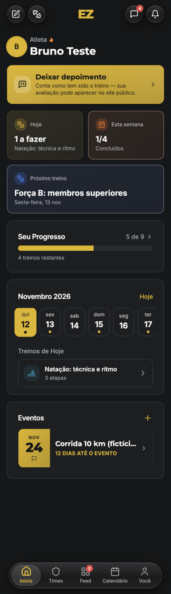
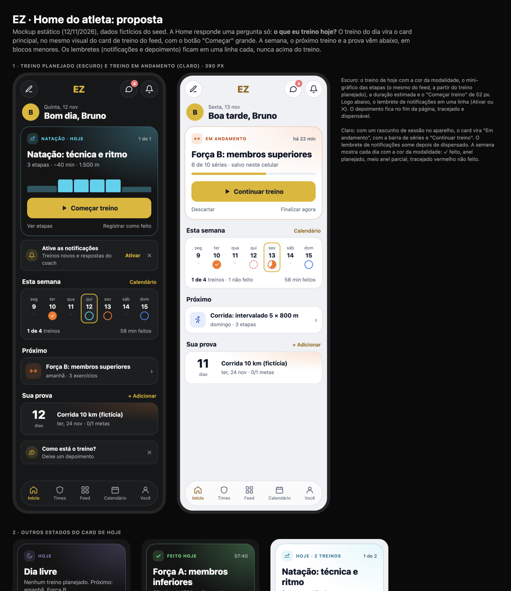
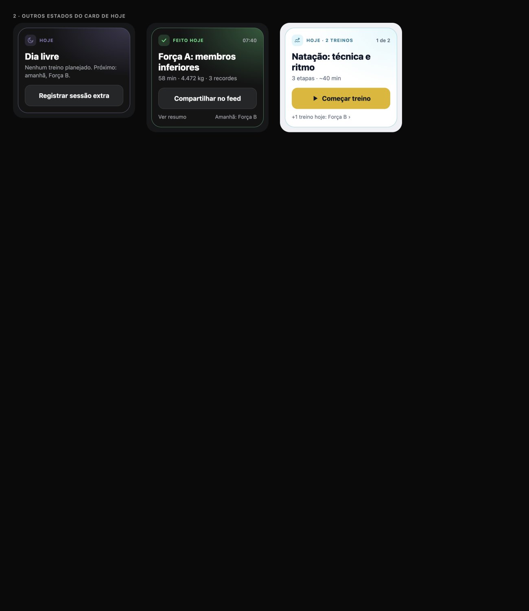

# Home do atleta (/athlete): diagnóstico e proposta

**Data:** 12/11/2026 · **Quem:** EZ Design · **Base:** `main` d1592fa · **Guia:** `docs/design/design-system.md` · **Linguagem:** feed, chat e "Você" (`docs/design/feed`, `chat`, `profile`)
**Mockup:** [`home-mockup.html`](home-mockup.html) · **Prévias:** [`img/`](img/)

Testado no emulador em 390 px, tema escuro, com a conta fictícia `bruno@ez.test`. O `PushInvite` não aparece no navegador de teste (depende do estado da permissão), então foi revisto pelo código (`src/components/push/PushInvite.tsx`).

## 1. Diagnóstico

### Principais problemas
1. **O treino de hoje não é o protagonista.** "Hoje · 1 a fazer" é um card pequeno, do mesmo tamanho de "Esta semana", e não tem botão de começar. O treino de verdade aparece só lá embaixo, em "Treinos de hoje", depois da faixa de datas: são 2 toques e uma rolagem para começar.
2. **Lembretes acima de tudo.** O depoimento (amarelo cheio) e o novo `PushInvite` ficam **acima** do treino. Com os dois visíveis, o treino de hoje cai para a metade da tela.
3. **Blocos redundantes:**
   - "Hoje", "Esta semana" e "Seu progresso (5 de 9)" contam quase a mesma coisa;
   - a faixa de datas infinita repete o Calendário.
   - São 5 tons de gradiente (amarelo, laranja, azul, índigo, verde) que não seguem a cor da modalidade. O card "Hoje" mostra sempre o ícone de halter, mesmo quando o treino é de natação.
4. **A semana não mostra o que importa.** Os pontos amarelos na faixa só dizem "tem treino"; não mostram a modalidade nem se foi feito, parcial ou não feito.
5. **A prova tem pouco peso.** "12 DIAS ATÉ O EVENTO" aparece em caixa alta amarela e o nome é cortado ("Corrida 10 km (fictíci…").

## 2. Proposta

**Ordem nova:** saudação → **card de hoje** → lembrete de notificações (1 linha) → esta semana → próximo treino → sua prova → depoimento (1 linha, no fim).

### 2.1 Saudação
"Bom dia, Bruno" com a data curta. O avatar continua abrindo o menu (como hoje). Sai o "Atleta 🔥".

### 2.2 Card de hoje (o principal)
É o mesmo card de treino do feed, no tamanho grande, com a cor da modalidade (`--workout-card` + brilho `--sport-*`). Mostra:
- linha de cima com modalidade · hoje, e "1 de 2" quando há mais de um treino no dia;
- nome do treino em `text-title-lg`;
- metadados: "3 etapas · ~40 min · 1.500 m";
- **mini-gráfico das etapas**, igual ao do feed;
- **"Começar treino"** de 52 px, em `bg-primary`;
- links secundários "Ver etapas" e "Registrar como feito".

**Estados do card:**

| Estado | Quando | Conteúdo |
|---|---|---|
| Planejado | há treino hoje e não foi feito | "Começar treino" |
| **Em andamento** | há rascunho da sessão no aparelho (`loadSessionDraft`, já existe) | barra de séries, "há 22 min", **"Continuar treino"**; "Descartar" e "Finalizar agora" |
| Feito hoje | concluído hoje | números do feed (tempo, volume, recordes), "Compartilhar no feed", "Ver resumo" |
| Dia livre | nada hoje | "Próximo: amanhã, Força B" + "Registrar sessão extra" |
| 2+ treinos | mais de um no dia | o 1º pendente em destaque e "+1 treino hoje ›" |

**Dados:**
- A duração (~40 min) e a distância somam só as etapas por tempo e por distância do treino planejado. Se alguma etapa for por volta ou calorias, mostre só o que dá para somar. **Não precisa de dado novo.**
- O mini-gráfico precisa de um adaptador `vizModelFromWorkout(workout)`, porque o `vizModel` atual recebe o `WorkoutSummary` (treino concluído). Ele usa os mesmos dados do treino.

### 2.3 Lembretes
- **Notificações (`PushInvite`):** 1 linha (ícone, título, subtítulo), [Ativar] e ✕, logo **abaixo** do card de hoje. A lógica de quando aparecer não muda.
- **Depoimento:** 1 linha tracejada **no fim** da página, dispensável. É o mesmo `mode="nudge"` da tarefa PR-2 da tela "Você".

### 2.4 Esta semana
- 7 dias, de seg a dom. Cada dia mostra a cor da modalidade:
  - ✓ cheio para feito;
  - anel para planejado;
  - meio anel para parcial;
  - anel tracejado vermelho para não feito;
  - ponto cinza para dia livre.
- O dia de hoje tem contorno amarelo. Tocar num dia abre o Calendário naquele dia.
- Resumo: "1 de 4 treinos · 58 min feitos".
- **Substitui** a faixa infinita de datas, "Esta semana 1/4" e "Seu progresso 5 de 9".

### 2.5 Próximo e prova
- **Próximo:** linha com o ícone da modalidade na cor, o nome e "amanhã · 3 exercícios".
- **Sua prova:** a contagem em número grande ("12 dias"), o nome inteiro e "ter, 24 nov · 0/1 metas". É o mesmo visual de Eventos da tela "Você", em versão compacta.

## 3. Backlog para o EZ Frontend (em ordem)

**⭐ = maior ganho em ~1 dia** (HA-1 a HA-3).

| ID | Tarefa | Tam. | Arquivos |
|---|---|---|---|
| ⭐ HA-1 | **Card de hoje** com os 5 estados, "Começar/Continuar" de 52 px, cor da modalidade, duração e distância somadas das etapas. Reaproveitar o `WorkoutSummaryCard`/`--workout-card` do feed. | M | `src/pages/athlete/Home.tsx:193-215, 263-290`, `src/components/athlete/TodayCard.tsx` (novo) |
| ⭐ HA-2 | **Nova ordem e lembretes de 1 linha:** `PushInvite` abaixo do card de hoje (variante compacta); depoimento no fim, com `mode="nudge"`. | P | `Home.tsx:263-268`, `src/components/push/PushInvite.tsx` (prop `compact`), `src/components/athlete/LeaveTestimonialBanner.tsx` |
| ⭐ HA-3 | **"Esta semana" com 7 dias e status por modalidade**, substituindo a faixa de datas, os cards "Hoje"/"Semana" e "Seu progresso". | M | `Home.tsx` (StatCards, Progress card, `InfiniteDateStrip`), `src/components/athlete/WeekStrip.tsx` (novo) |
| HA-4 | **Mini-gráfico do treino planejado:** `vizModelFromWorkout()` + `WorkoutViz` reaproveitado. | P | `src/components/timeline/workout-viz/vizModel.ts` |
| HA-5 | **Próximo treino e prova** em versão compacta (sem caixa alta, nome inteiro em 2 linhas). | P | `Home.tsx`, `src/components/athlete/EventCard.tsx` (`variant="compact"`) |
| HA-6 | **Saudação** (Bom dia/tarde/noite + data), sem o "Atleta 🔥". Remover `react-icons` (`GrRun`…) do arquivo. | P | `Home.tsx:240-262, 27` |
| HA-7 | QA em 375 e 390 px, nos temas claro e escuro, nos 5 estados do card (EZ QA; o seed já tem parcial e treino de hoje). | P | testes do EZ QA |

**Ordem:** HA-1 → HA-2 → HA-3 (≈ 1 dia) → HA-4 → HA-5 → HA-6 → HA-7.
