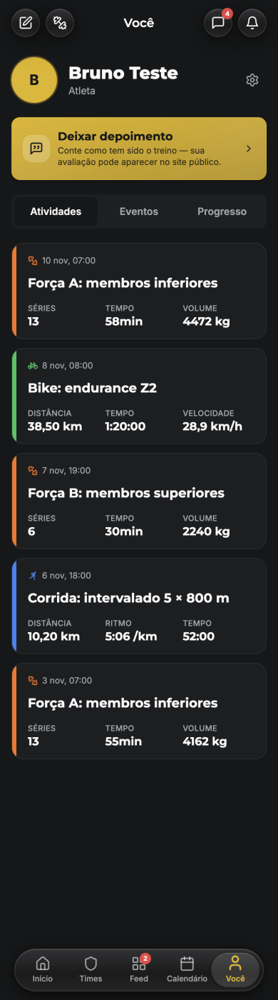
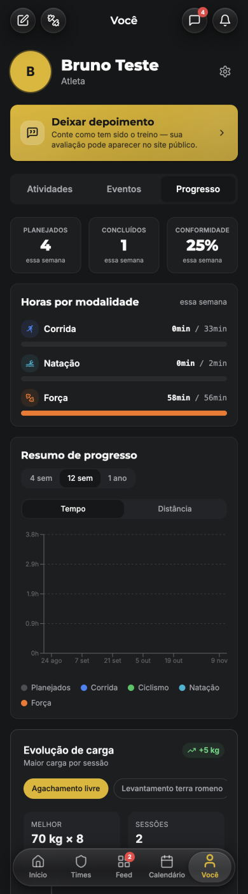
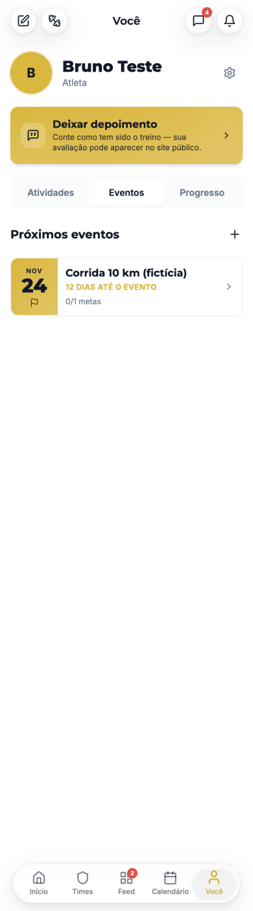
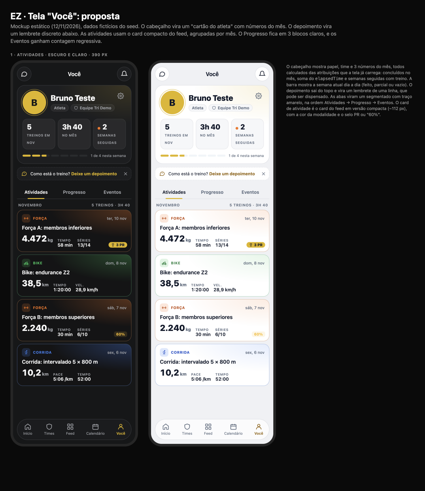
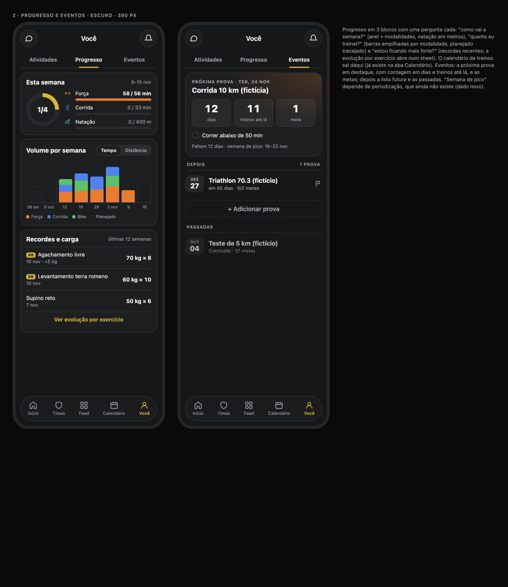

# Tela "Você" (/athlete/profile): diagnóstico e proposta

**Data:** 12/11/2026 · **Quem:** EZ Design · **Base:** `main` 0cfe409 · **Guia:** `docs/design/design-system.md` · **Linguagem:** cards do feed (`docs/design/feed`) e chat (`docs/design/chat`)
**Mockup:** [`profile-mockup.html`](profile-mockup.html) · **Prévias:** [`img/`](img/)

Testado no emulador em 390 px, nos temas escuro e claro. Usei a conta **bruno@ez.test**, que já estava logada no navegador de teste. Ela também é fictícia do seed e tem mais variedade que a da Ana (treino parcial e mais atividades). Nada foi gravado.

---

## 1. Diagnóstico

| Atividades (escuro) | Progresso (escuro) | Eventos (claro) |
|---|---|---|
|  |  |  |

### Os 5 principais problemas
1. **O topo não fala do atleta.**
   - O cabeçalho tem só avatar, nome e "Atleta", sem time e sem nenhum número.
   - O maior bloco da dobra é o **banner amarelo de depoimento**, que é um pedido do coach e não uma informação do atleta.
   - Ele está em amarelo cheio, a cor de ação principal, e repete o banner que já aparece na Home.
2. **Os cards de atividade não seguem a linguagem nova do feed.**
   - Usam uma barra colorida à esquerda e 3 números do mesmo tamanho, sem número principal.
   - O treino parcial (60%) aparece igual ao completo.
   - Recordes não aparecem, e a data mostra a hora ("10 nov, 07:00"), que não ajuda.
   - Números fora do padrão: "4472 kg" (sem separador), "38,50 km" (duas casas), "58min" (sem espaço).
   - A lista é plana, sem agrupar por mês e sem total.
3. **A aba Progresso é longa e confusa.**
   - São 6 blocos empilhados (3 KPIs, horas por modalidade, resumo, evolução de carga, calendário, resumo total), com cerca de 2.000 px de rolagem.
   - O "Resumo de progresso" fica **vazio** com 5 treinos concluídos. O eixo vem com "0.9h / 1.9h" e a legenda tem 5 itens para nenhuma barra.
   - "Natação 0min / 2min" mostra meta de tempo para um treino por distância.
   - Os números usam fonte mono, uma terceira família.
   - O calendário de treinos repete a aba Calendário.
4. **Os Eventos são uma linha só.**
   - A próxima prova, que é o que mais motiva, tem o mesmo peso de qualquer item.
   - A contagem aparece em caixa alta ("12 DIAS ATÉ O EVENTO"), sem as metas visíveis nem quanto treino falta.
   - Não há separação entre provas futuras e passadas.
   - No tema claro, o amarelo usado como texto fica ilegível, e a data em amarelo cheio pesa demais.
5. **Abas e estados sem padrão.**
   - As abas usam um segmentado cinza, diferente do padrão das outras telas.
   - A ordem Atividades / Eventos / Progresso mistura frequência de uso.
   - Os estados vazios são texto solto, sem ação.
   - O carregamento é um skeleton genérico (avatar + 2 blocos) que não tem a forma da tela final.

---

## 2. Proposta

### 2.1 Cartão do atleta (cabeçalho)
- Card `rounded-3xl` com um brilho amarelo discreto num canto (16%).
- Avatar de 72 px com anel amarelo, nome em `text-title-lg` (Montserrat 800) e chips de **papel** e **time**.
- A engrenagem fica no canto, com 44 px.
- **3 números do mês**, em `text-metric-md`:
  - treinos concluídos no mês;
  - horas no mês (soma do `elapsedTime`);
  - **semanas seguidas** com pelo menos 1 treino concluído.
- **Barra da semana:** 7 segmentos (feito, parcial ou vazio) + "1 de 4 nesta semana".
- **Dados:** tudo sai das atribuições que a tela já carrega (`completedAt`, `elapsedTime`, `completionPercentage`). O time vem de `teams` com `memberIds` (a leitura já existe na aba Times). **Nada novo.**

### 2.2 Depoimento
- Vira um lembrete de **1 linha** abaixo do cartão: borda tracejada, ícone, link em `primary-ink` e ✕ para dispensar.
- A dispensa fica salva no `localStorage` por 30 dias.
- Some de vez depois que o depoimento é enviado.

### 2.3 Abas
- Segmentado de texto com **traço amarelo** embaixo do ativo (o mesmo do feed).
- Nova ordem: **Atividades → Progresso → Eventos**.
- A aba continua na URL (`?tab=`), como hoje.

### 2.4 Atividades
- **Card compacto do feed** (~112 px):
  - fundo `--workout-card` com o brilho da modalidade (30% no escuro, 14% no claro) e borda na cor da modalidade;
  - na linha de cima: modalidade e data curta ("ter, 10 nov");
  - nome do treino;
  - **número principal** em Montserrat 26 + 2 secundários;
  - selo **PR** (amarelo) ou **"60%"** (alerta) no canto.
- O mesmo componente do feed, no tamanho `compact` (ver FD-4).
- **Agrupar por mês**, com o total no cabeçalho do grupo ("Novembro · 5 treinos · 3h 40").
- Números via `useFormat`: "4.472 kg", "38,5 km", "58 min".

### 2.5 Progresso: 3 blocos, uma pergunta cada
1. **Esta semana:**
   - anel de conclusão (x/y) e barras por modalidade;
   - **natação em metros** (sem meta de tempo para treino por distância).
2. **Volume por semana:**
   - barras **empilhadas por modalidade** (cores `--sport-*`);
   - o planejado aparece tracejado atrás;
   - seletor Tempo / Distância;
   - 8 semanas, com eixo em datas curtas e sem eixo Y numérico (o rótulo aparece no toque);
   - estado vazio próprio.
3. **Recordes e carga:**
   - os 3 recordes mais recentes (exercício, carga × reps, data e ganho);
   - "Ver evolução por exercício" abre o gráfico atual (`StrengthProgressChart`) num sheet.
- **Saem:** o calendário de treinos (já existe na aba Calendário), o "Resumo total" e os 3 KPIs soltos (agora estão no cartão do atleta e no bloco 1).
- **Dados:** os mesmos de hoje. 🔧 O gráfico de volume vem vazio no seed com 5 treinos; investigar com o EZ Backend (é o mesmo problema que já foi visto no coach, C7).

### 2.6 Eventos
- **A próxima prova em destaque:**
  - card com brilho laranja;
  - "Próxima prova · ter, 24 nov";
  - **contagem regressiva** em 3 blocos: dias, **treinos até lá** (atribuições pendentes até a data) e metas;
  - a lista de metas com checkbox.
- Depois: as provas futuras ("em 45 dias · 0/2 metas"), [+ Adicionar prova] e **Passadas** esmaecidas, com o resultado das metas.
- "Semana de pico" **⛔ precisa de dado novo** (periodização). Fica fora até existir.
- A meta "Correr abaixo de 50 min" e a prova passada "Teste de 5 km" do mockup são **dados de exemplo**.

### 2.7 Estados
- **Carregando:** skeleton com a forma da tela (cartão do atleta + 3 cards compactos).
- **Sem atividades:** `EmptyState` "Seu primeiro treino concluído aparece aqui" + [Ver treinos de hoje].
- **Sem eventos:** "Nenhuma prova marcada" + [Adicionar prova].
- **Progresso sem dados:** um `EmptyState` compacto em cada bloco.

---

## 3. Backlog para o EZ Frontend (em ordem)

**⭐ = maior ganho visual em ~1 dia** (PR-1 a PR-4).

| ID | Tarefa | Tam. | Arquivos |
|---|---|---|---|
| ⭐ PR-1 | **Cartão do atleta:** avatar de 72 px, chips de papel e time, 3 números do mês, barra da semana; cálculos num hook `useAthleteStats(assignments)` (com teste). | M | `src/pages/athlete/Profile.tsx:125-150`, `src/hooks/useAthleteStats.ts` (novo), leitura do time via o serviço que a aba Times já usa |
| ⭐ PR-2 | **Depoimento como lembrete** de 1 linha, dispensável por 30 dias. | P | `src/components/athlete/LeaveTestimonialBanner.tsx` (novo `mode="nudge"`), `Profile.tsx:150` |
| ⭐ PR-3 | **Card de atividade compacto** no visual do feed (modalidade, número principal, selo PR ou parcial, data curta, `useFormat`) + agrupamento por mês com total. Se a FD-4 já existir, usar o componente dela no tamanho `compact`. | M | `src/components/athlete/ActivityCard.tsx`, `Profile.tsx:256-270` (também usado no portal do coach: conferir lá) |
| ⭐ PR-4 | **Abas** com traço amarelo, nova ordem, skeleton na forma da tela. | P | `Profile.tsx:107-121, 152-161` |
| PR-5 | **Progresso em 3 blocos:** "Esta semana" (anel + modalidades, natação em m), "Volume por semana" (barras empilhadas, planejado tracejado, vazio), "Recordes e carga" (top 3 + sheet com o `StrengthProgressChart`). Remover o calendário, o resumo total e a fonte mono. 🔧 conferir por que o volume vem vazio. | G | `Profile.tsx:163-210, 337`, `src/components/athlete/ProgressSummaryChart.tsx`, `StrengthProgressChart.tsx` |
| PR-6 | **Eventos:** próxima prova em destaque com contagem (dias, treinos até lá, metas), lista futura, passadas esmaecidas. | M | `Profile.tsx:212-254`, `src/components/athlete/EventCard.tsx` |
| PR-7 | **Estados vazios** com ação (atividades, eventos, blocos do progresso). | P | `Profile.tsx` (`EmptyState`), `src/components/feedback/*` |
| PR-8 | QA visual em 375 e 390 px, nos temas claro e escuro (EZ QA). | P | testes do EZ QA |

**Ordem:** PR-1 → PR-2 → PR-3 → PR-4 (≈ 1 dia, muda a primeira impressão da tela) → PR-6 → PR-5 → PR-7 → PR-8.
