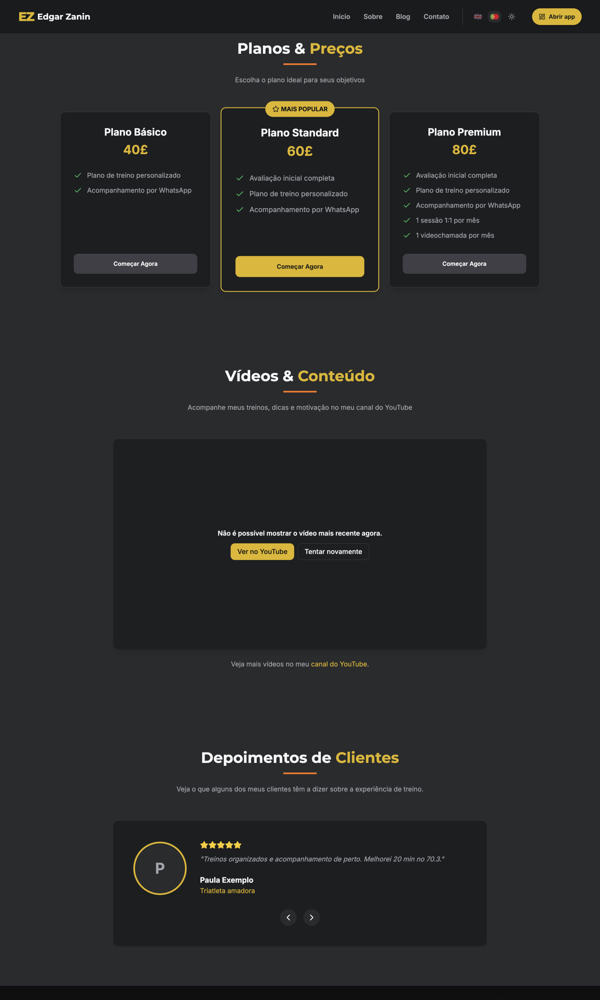
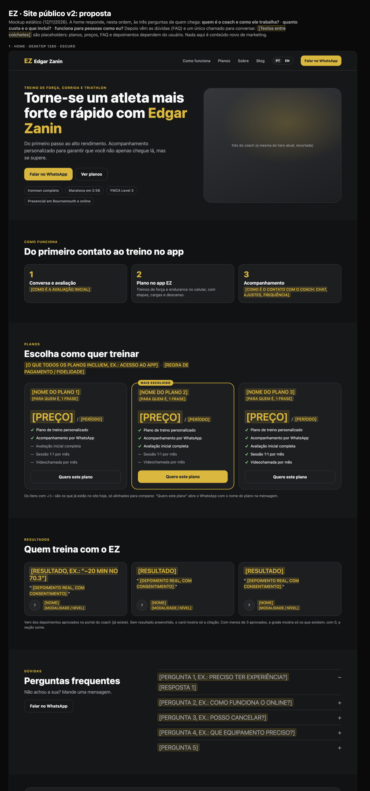
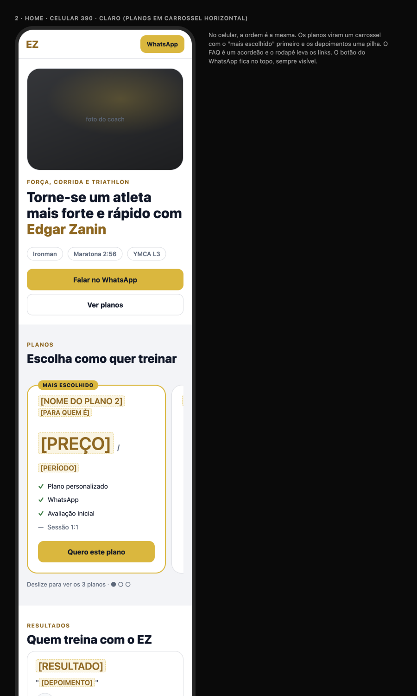

# Site público v2 (/, /about, /blog, /contact): diagnóstico e proposta

**Data:** 12/11/2026 · **Quem:** EZ Design · **Base:** `main` 27e671b · **Guia:** `docs/design/design-system.md` · **Antes:** `docs/ux-audit/2026-11-12-public-site.md` (auditoria de hoje cedo; parte já foi corrigida)
**Mockup:** [`site-mockup.html`](site-mockup.html) · **Prévias:** [`img/`](img/)

**Perguntas que a home responde (princípio do EZ Lead):**
1. **Quem é o coach e como ele trabalha?**
2. **Quanto custa e o que inclui?**
3. **Funciona para pessoas como eu?**

**Regra de conteúdo:** planos, preços, FAQ e depoimentos dependem do usuário. No mockup, eles aparecem como `[PLACEHOLDERS]`. Não inventei conteúdo de marketing, preços, depoimentos nem dados do coach. O que aparece fora de colchetes já está no site hoje: a frase do hero, os itens dos planos e os fatos do "Sobre" (Ironman, maratona 2:56, YMCA L3, Bournemouth).

Testado no emulador (`localhost:8090`), desktop, tema escuro.

## 1. Diagnóstico

### Principais problemas
1. **Os planos não deixam comparar.** A lista de itens muda de plano para plano (2, 3 e 5 itens). Faltam o período ("40£" por quê?), o "para quem é" e qualquer regra (fidelidade, pagamento). Os 3 botões "Começar agora" levam ao mesmo lugar, sem dizer o plano.
2. **Prova social fraca.** Um único depoimento, num carrossel que mostra 1 por vez e esconde os outros. Não há resultado (o que mudou para o aluno).
3. **Não há FAQ.** As dúvidas comuns (experiência, online, cancelamento, equipamento) ficam sem resposta e viram mensagens no WhatsApp.
4. **Blocos que não ajudam a decidir:**
   - "Meus serviços" com 4 cards genéricos (força, resistência, HIIT, provas);
   - o card "Pronto para transformar seu condicionamento?", que repete o hero;
   - o bloco de vídeo, que quando falha vira uma caixa vazia de ~500 px.
   - O hero estica com a altura da tela (`h-[95vh]`) e, em monitores altos, empurra tudo para baixo.
5. **Ainda há ruído visual:** títulos de seção com a palavra amarela e a barra laranja repetidos em todas as seções, e espaçamento de ~200 px entre elas (itens 20 e 21 da auditoria).

## 2. Proposta

**Ordem da home:** hero → como funciona → planos → resultados → FAQ → chamada final (+ link do YouTube) → rodapé.

| Seção | Responde | Conteúdo |
|---|---|---|
| **Hero** | Quem é | Frase atual; 2 botões (Falar no WhatsApp, Ver planos); 4 chips de prova com dados que **já estão no "Sobre"**; foto do coach com altura fixa (sem `95vh`). |
| **Como funciona** | Como trabalha | 3 passos: avaliação `[TEXTO]`, plano no app (descrição do app, que já existe), acompanhamento `[TEXTO]`. Substitui "Meus serviços". |
| **Planos** | Quanto custa | Os 3 planos com **a mesma lista de itens** (✓/—, os itens de hoje), `[NOME]`, `[PARA QUEM É]`, `[PREÇO] / [PERÍODO]`, `[REGRA]`. "Quero este plano" abre o WhatsApp com o nome do plano no texto. No celular, carrossel com o "mais escolhido" primeiro. |
| **Resultados** | Funciona para mim | Grade de até 3 depoimentos aprovados (já existem no portal do coach), com `[RESULTADO]` em destaque, citação, nome e modalidade. Com 0 aprovados, a seção some. |
| **FAQ** | Dúvidas | Acordeão com 5 `[PERGUNTA]/[RESPOSTA]` + "Falar no WhatsApp". |
| **Chamada final** | Próximo passo | "Vamos conversar sobre o seu objetivo?" + `[PRAZO DE RESPOSTA]` + 1 botão. YouTube como **uma linha** com link para o canal. |

**/about, /blog, /contact** (mesma linguagem; sem mockup próprio):
- **Sobre:** a foto e o texto atuais, os 4 recordes como chips e as certificações numa lista. Sai o título "Minhas conquistas" duplicado (auditoria #25).
- **Blog:** com menos de 3 posts, um post em destaque (card largo); o artigo segue o guia (sem e-mail do autor, data com locale).
- **Contato:** um bloco com WhatsApp (botão principal), telefone, cidade e horário com fuso `[CONFIRMAR]`. Os dois CTAs iguais viram um.

### 2.1 O que saiu (e por quê)
| Saiu | Por quê |
|---|---|
| "Meus serviços" (4 cards genéricos) | Não ajuda a decidir; virou "Como funciona" (3 passos concretos). |
| Card "Pronto para transformar seu condicionamento?" | Repete o hero e o CTA; a chamada final faz esse papel uma vez. |
| Bloco grande de vídeo do YouTube | Quando falha, é uma caixa vazia; quando funciona, não responde a nenhuma das 3 perguntas. Virou um link de uma linha. |
| Carrossel de 1 depoimento | Esconde a prova social; virou grade (e some quando não houver). |
| Barra laranja e palavra amarela em todo título | Ruído repetido; o rótulo pequeno em amarelo basta. |
| Hero com altura da tela | Empurra o conteúdo em telas altas; agora a altura vem do conteúdo. |

### 2.2 Dados
- **Nada novo** para planos, FAQ e layout: são textos (traduções).
- **Resultado no depoimento** ("−20 min no 70.3") **⛔ precisa de um campo opcional novo** (`result`) no depoimento e no formulário de aprovação do coach. Sem ele, o card mostra só a citação.
- Os textos `[ENTRE COLCHETES]` são do usuário: planos e preços, regra de pagamento, como é a avaliação e o acompanhamento, FAQ, prazo de resposta, e telefone/fuso do contato.

## 3. Backlog para o EZ Frontend (em ordem)

**⭐ = maior ganho em ~1 dia** (PS-1 + PS-2), só com o conteúdo que existe hoje. Os textos novos entram quando o usuário mandar.

| ID | Tarefa | Tam. | Arquivos |
|---|---|---|---|
| ⭐ PS-1 | **Planos comparáveis:** mesma lista de itens (✓/—), espaços para período, "para quem é" e regra (escondidos enquanto vazios); "Quero este plano" com o nome do plano no texto do WhatsApp; carrossel no celular. | M | `src/components/PricingSection.tsx`, `src/translations/{pt,en}.json` |
| ⭐ PS-2 | **Enxugar a home:** remover "Meus serviços" e o card "Pronto para transformar"; YouTube como link de uma linha; hero com altura do conteúdo e chips de prova; títulos de seção com rótulo, sem barra laranja. | M | `src/pages/Index.tsx`, `src/components/HeroSection.tsx`, `ServicesSection.tsx` (sai), `YouTubeSection.tsx`, `src/index.css` |
| PS-3 | **Resultados em grade** (até 3 aprovados, some com 0) + 🔧 campo opcional `result` (EZ Backend + formulário do coach). | M | `src/components/TestimonialsSection.tsx`, `src/types/testimonial.ts`, `src/pages/admin/Testimonials.tsx` |
| PS-4 | **"Como funciona"** (3 passos) com os textos do usuário. | P | `src/components/HowItWorksSection.tsx` (novo), traduções |
| PS-5 | **FAQ** em acordeão (`Accordion` do shadcn, já instalado) com os textos do usuário + `FAQPage` no JSON-LD (SEO). | P | `src/components/FaqSection.tsx` (novo), traduções, `src/components/Seo.tsx` |
| PS-6 | **Chamada final** única com prazo de resposta. | P | `src/pages/Index.tsx` |
| PS-7 | **Sobre / Blog / Contato** no padrão: chips de recorde, post em destaque, um CTA no contato. | M | `src/pages/About.tsx`, `BlogPage.tsx`, `Contact.tsx` |
| PS-8 | QA em 375, 390, 1280 e 1440 px, claro e escuro, PT e EN, com 0, 1 e 3 depoimentos (EZ QA). | P | testes do EZ QA |

**Ordem:** PS-1 → PS-2 (≈ 1 dia) → PS-3 → PS-4 / PS-5 / PS-6 (quando os textos chegarem) → PS-7 → PS-8.

## 4. Conteúdo que o usuário precisa mandar
1. Para cada plano: nome, para quem é (1 frase), preço e período, e o que muda entre eles (se os itens de hoje não bastarem).
2. Regra de pagamento e fidelidade.
3. Como é a avaliação inicial e como é o acompanhamento (chat, ajustes, frequência).
4. 4–6 perguntas frequentes com respostas.
5. Até 3 depoimentos com consentimento e, se possível, o resultado de cada um.
6. Prazo de resposta no WhatsApp; telefone e fuso do horário no Contato.
