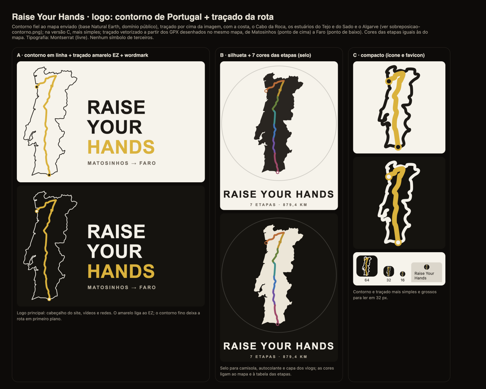
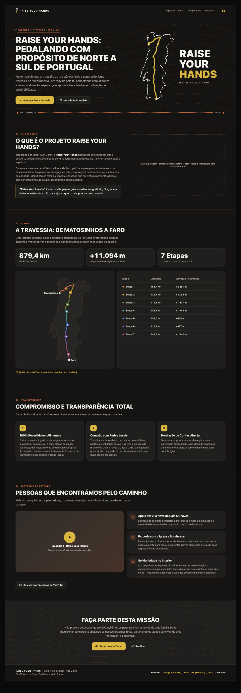
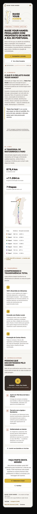

# Raise Your Hands: landing page e logo

**Data:** 13/11/2026 · **Quem:** EZ Design · **Base:** `main` 5619ccd · **Onde vai morar:** `raiseyourhands.edgarzanin.com` e `/raise-your-hands`
**Conteúdo:** `ez-project/raise-your-hands/conteudo.md` (pt-PT do usuário, usado **sem alterações**) · **Mapa de referência:** `ez-project/raise-your-hands/mapa-rota.jpeg`
**Mockup:** [`landing-mockup.html`](landing-mockup.html) · **Logo:** [`logo/`](logo/) ([prancha](logo/prancha-logo.png)) · **Prévias:** [`img/`](img/)

## 1. Logo

- **Forma:** contorno de Portugal **fiel ao mapa enviado** (base Natural Earth, domínio público), traçado pela borda da área de terra da imagem e limpo só do ruído: costa recortada, Cabo da Roca, estuários do Tejo e do Sado, Algarve. Conferido por sobreposição: [`logo/sobreposicao-contorno.png`](logo/sobreposicao-contorno.png). Com o **traçado da rota** dentro, vetorizado do mesmo mapa (Matosinhos → Faro), e os pontos de início e fim.
- **A · linha + wordmark** (principal): contorno em linha fina, traçado em amarelo EZ, "RAISE YOUR HANDS" em Montserrat 900.
- **B · silhueta + 7 cores** (selo): contorno preenchido e traçado nas cores das etapas (as mesmas do mapa).
- **C · compacto** (ícone e favicon): mesma forma, mais simplificada, com traço grosso; lê em 32 px. Em 16 px vira só a forma.
- **Arquivos:** `ryh-{a,b,c}-…-{claro,escuro}.svg` + `ryh-c-favicon.svg`.
- **Antes de usar em produção:**
  - o texto dos SVG usa `<text>` com Montserrat; converter em contornos;
- **Mãos erguidas:** ficou de fora; qualquer forma de mão virava clip-art. O traçado já sobe de Faro a Matosinhos de baixo para cima.

## 2. Landing
| Desktop escuro | Celular claro |
|---|---|
|  |  |

- **Identidade:** expedição/estrada.
  - Grafite quente e areia, com terracota para rótulos.
  - Amarelo EZ nos botões principais e no traçado.
  - Montserrat/Inter, como o EZ.
  - Linhas de relevo **decorativas** no hero e na chamada final.
- **Seções**, na ordem do conteúdo:
  1. Hero: badge, H1, texto, "Acompanhar a Jornada" e "Ver a Rota Completa" (âncora `#rota`), com o logo A ao lado.
  2. Propósito.
  3. Rota: os 3 destaques, o traçado em SVG com as 7 cores e marcadores 1–7, e a tabela com a cor de cada etapa.
  4. Transparência: 3 pilares.
  5. Histórias: prévia do episódio 1 e 3 cards de relatos, sem fotos de pessoas.
  6. Chamada final e rodapé.
- **Decisões do usuário aplicadas:**
  - "Quero Apoiar o Projeto" saiu; a chamada final tem só "Subscrever o Canal" e "Partilhar" (Web Share, sem dado novo).
  - A playlist é usada em "Assistir aos Episódios" e na prévia do episódio 1 (facade nocookie, carrega só no toque).
- **Placeholders:**
  - `[FOTO: …]` na seção Propósito;
  - `[LINK]` para Instagram e para a rota no Komoot.
  - Sem fotos de banco nem do site atual.
- **Para o usuário confirmar:** a soma da elevação na tabela dá +11.095 m; o destaque diz +11.094 m. Mantive os dois como estão no texto (provável arredondamento).

## 3. Tarefas para o EZ Frontend
| ID | Tarefa | Tam. |
|---|---|---|
| ⭐ RYH-1 | Página `/raise-your-hands` (pt-PT, `lang="pt-PT"`) com as 6 seções do mockup e texto exatamente do `conteudo.md`; claro e escuro. | M |
| ⭐ RYH-2 | `RouteMap` em SVG: reaproveitar os caminhos do logo (contorno + 7 etapas + pontos); tabela acessível (`<table>` com cabeçalhos). | P |
| ⭐ RYH-3 | `YouTubeFacade`: prop opcional `list`, para o embed abrir a playlist a partir do episódio 1 (`yfP5Hc2pVU8`, `list=PLQbIGtMF-qUqyVCITHBpSVUpeE97DDxMI`). "Assistir aos Episódios" e "Subscrever o Canal" como links externos. | P |
| RYH-4 | Subdomínio: rewrite por host em `vercel.json` (`raiseyourhands.edgarzanin.com` → `/raise-your-hands`); domínio e DNS ficam com o usuário. | P |
| RYH-5 | Favicon (logo C), `og:image` (logo B), título e descrição do hero via `Seo`. | P |
| RYH-6 | "Partilhar": `navigator.share`, ou copiar o link com toast. | P |
| RYH-7 | Placeholders: esconder Instagram, Komoot e a foto enquanto vazios; preencher quando o usuário mandar. | P |
| RYH-8 | QA em 390 e 1440 px, claro e escuro, teclado e contraste AA (EZ QA). | P |

**Ordem:** RYH-1 → RYH-2 → RYH-3 (≈ 1 dia) → RYH-4 → RYH-5 → RYH-6 → RYH-7 → RYH-8.
