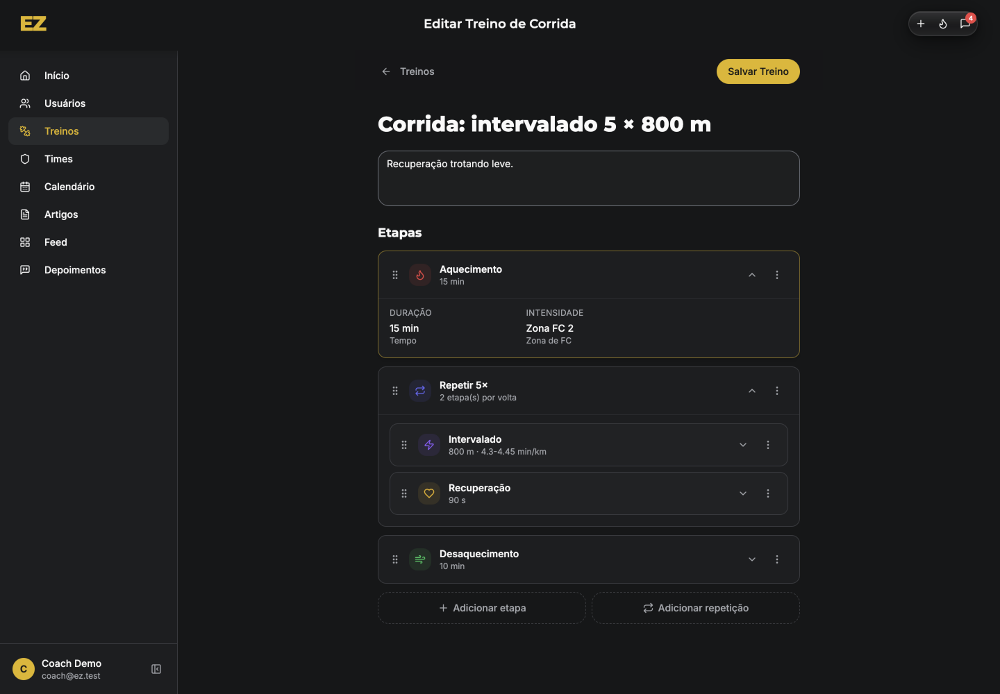
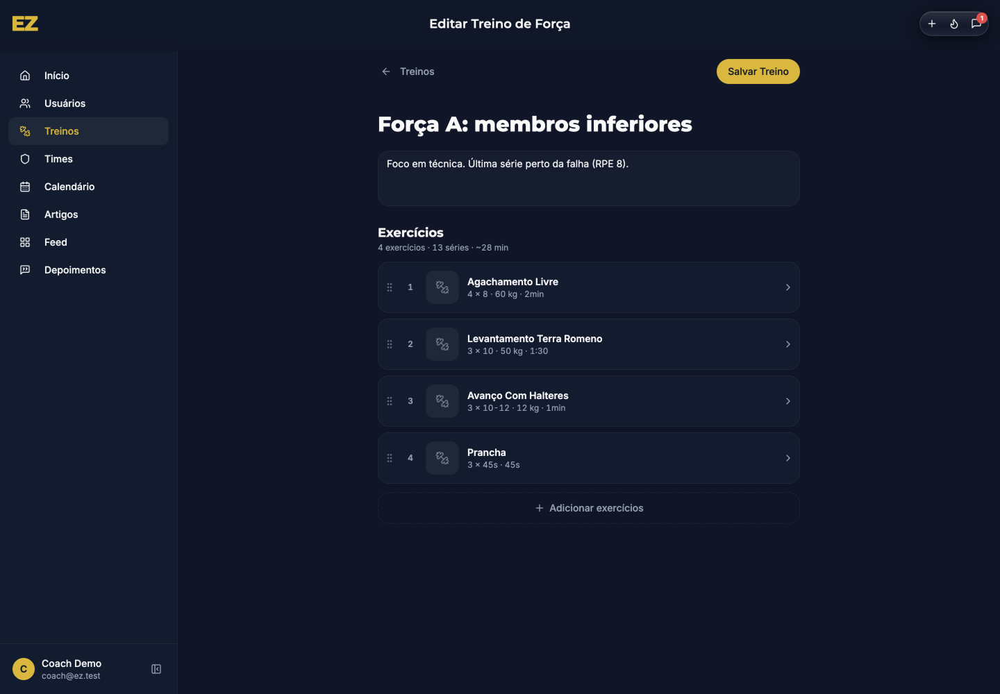
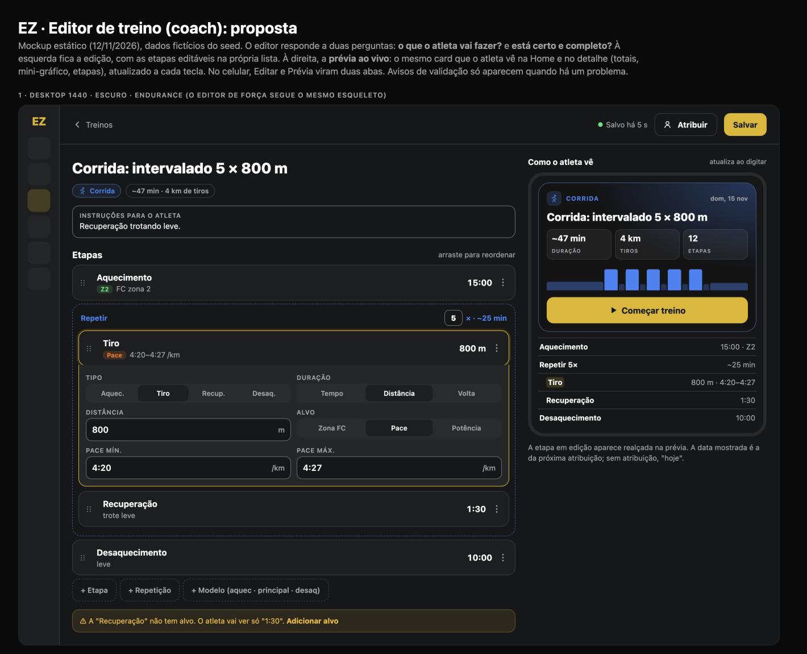
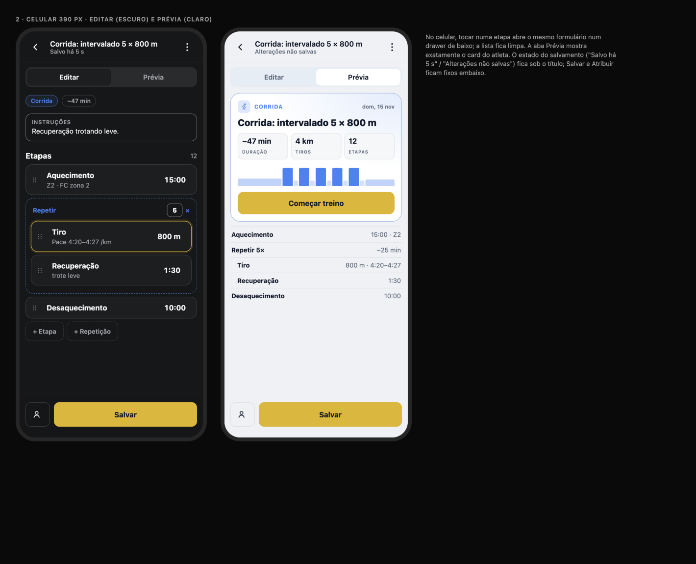

# Editor de treino do coach: diagnóstico e proposta

**Data:** 12/11/2026 · **Quem:** EZ Design · **Base:** `main` 1c9627f · **Guia:** `docs/design/design-system.md` · **Linguagem:** card de treino do feed e detalhe do treino (`docs/design/workout-screens`)
**Mockup:** [`editor-mockup.html`](editor-mockup.html) · **Prévias:** [`img/`](img/)

**Perguntas que a tela responde (princípio do EZ Lead):**
1. **O que o atleta vai fazer?**
2. **Está certo e completo?**

Testado no emulador como `coach@ez.test`, em 1440 px, tema escuro: editor de endurance (`demo-wk-run-intervals`). A captura do editor de força é desta manhã, com as cores antigas; a estrutura não mudou. Nada foi salvo.

## 1. Diagnóstico

| Endurance (etapa aberta) | Força |
|---|---|
|  |  |

### Principais problemas
1. **O coach não vê o que o atleta vai ver.**
   - Não há prévia, nem totais (duração, distância), nem a forma do treino.
   - O coach monta etapa por etapa e só descobre o resultado abrindo o app do atleta.
2. **Abrir uma etapa mostra só um resumo de leitura** ("DURAÇÃO 15 min · INTENSIDADE Zona FC 2"). A edição fica em outro painel. Sobram 2 cliques e mudança de contexto para cada ajuste.
3. **Pace decimal e formatos misturados.**
   - "4.3–4.45 min/km" (o mesmo problema da auditoria de endurance, item 3);
   - "90 s" ao lado de "15 min";
   - "2 etapa(s) por volta".
4. **O espaço do desktop fica sem uso.** Uma coluna de ~600 px no meio de 1.440 px, com o título duas vezes ("Editar Treino de Corrida" na barra e o nome do treino como h1).
5. **Sem validação visível.** Dá para salvar uma etapa sem alvo ou um bloco vazio (auditoria 1.4/18).
   - O editor de endurance não avisa sobre alterações não salvas; o de força só tem `beforeunload` (`StrengthWorkoutEditor.tsx:371`).
   - Os ícones das etapas (chama, raio, coração, vento) são decorativos e cada um tem uma cor.

## 2. Proposta

### 2.1 Layout
- **Desktop:** edição à esquerda (flexível) e **prévia ao vivo** à direita (420 px, fixa ao rolar).
- **Celular:** abas **Editar / Prévia** abaixo do cabeçalho.
- **Barra superior única:**
  - ← Treinos;
  - estado do salvamento ("Alterações não salvas" ou "Salvo há 5 s");
  - **Atribuir** (abre o modal de atribuição com este treino);
  - **Salvar**.
  - Sai o título repetido na barra de vidro.

### 2.2 Edição
- **Nome** editável no próprio título, chip da modalidade e "~47 min · 4 km de tiros" (totais calculados).
- **Instruções para o atleta:** um campo com rótulo.
- **Etapas:**
  - lista com alça de arrasto, nome, alvo como chip ("Z2", "Pace" + valor em mm:ss), duração em mm:ss à direita e ⋮ (duplicar, apagar com *undo*).
  - **Tocar na etapa abre o formulário logo abaixo dela** (no celular, num drawer). O formulário tem os campos que o `StageEditor` já tem: tipo, duração (tempo, distância ou volta), valor, alvo, mín. e máx. **Entrada em mm:ss** para tempo e pace.
- **Repetição:** bloco tracejado com o contador editável "5×" e a duração do bloco.
- **Adicionar:** "+ Etapa", "+ Repetição" e "+ Modelo" (aquecimento → principal → desaquecimento).
- **Validação só quando há problema:** uma faixa `warning` com o que falta e a ação ("Adicionar alvo"). Bloqueia salvar só em erro real (sem nome, bloco vazio, mín. > máx.).

### 2.3 Prévia ao vivo
- É o **mesmo componente** do detalhe do treino do atleta (WS-1), com dados do formulário e não do Firestore: card com modalidade, nome, totais, mini-gráfico e "Começar treino" (inativo); abaixo, a lista compacta de etapas.
- A **etapa em edição fica realçada** na prévia.
- Atualiza a cada tecla.
- **Força:** a prévia mostra o card da sessão (exercícios, séries × reps, carga, descanso) no visual da sessão de força (WS-3/WS-4).

### 2.4 O que saiu (e por quê)
| Saiu | Por quê |
|---|---|
| Título repetido ("Editar Treino de Corrida" + h1) | Um título basta; o nome do treino é o título. |
| Resumo de leitura ao abrir a etapa | O formulário abre direto; o resumo repetia a linha. |
| Ícones decorativos por tipo de etapa (chama, raio, coração, vento) | Cor e ícone vêm da modalidade e o tipo está no nome; o alvo vira chip. |
| Dois botões tracejados grandes de adicionar | Viraram 3 botões compactos, incluindo "Modelo". |
| Zonas com bpm/W fixos no texto | Mostrar só "Z2"; as faixas reais dependem do perfil do atleta (dado novo, fase 2). |

### 2.5 Dados e decisões
- **Nada novo** para o layout, a prévia, os totais e a validação.
- **Salvamento automático** ("Salvo há 5 s") é **decisão do usuário**. Sem ele, a barra mostra "Alterações não salvas" e o Salvar fica em destaque, com guarda ao sair (`useBlocker` + `beforeunload` nos dois editores).
- Zonas com faixas por atleta precisam do perfil fisiológico. **⛔ Dado novo**, já no backlog de produto.

## 3. Backlog para o EZ Frontend (em ordem)

**⭐ = maior ganho em ~1 dia** (WE-1 + WE-2).

| ID | Tarefa | Tam. | Arquivos |
|---|---|---|---|
| ⭐ WE-1 | **Prévia ao vivo** (desktop à direita, abas no celular) reaproveitando o card do detalhe (WS-1) com dados do formulário; totais e etapa realçada. | M | `src/pages/admin/WorkoutEditor.tsx`, `src/pages/admin/StrengthWorkoutEditor.tsx`, `src/components/workout/WorkoutPreview.tsx` (novo, usa o card de WS-1) |
| ⭐ WE-2 | **Barra superior única** (← Treinos, estado do salvamento, Atribuir, Salvar) e guarda de alterações não salvas nos dois editores. | P | `WorkoutEditor.tsx`, `StrengthWorkoutEditor.tsx`, `src/components/AdminTopBar.tsx` (sem título repetido) |
| WE-3 | **Edição na própria lista:** formulário abaixo da etapa (drawer no celular); entrada mm:ss para tempo e pace; alvo como chip; sem ícones decorativos. | M | `src/components/workout/StageEditor.tsx`, `WorkoutEditor.tsx` (lista de etapas) |
| WE-4 | **Validação** com faixa de aviso e bloqueio só em erro real (`validateWorkout()` compartilhado, auditoria 1.4). | P | `src/lib/validateWorkout.ts` (novo), os dois editores |
| WE-5 | **"+ Modelo"** (aquecimento, principal, desaquecimento) e *undo* ao apagar etapa ou exercício. | P | `WorkoutEditor.tsx`, `StrengthWorkoutEditor.tsx` |
| WE-6 | Editor de força no mesmo esqueleto: lista de exercícios à esquerda, biblioteca num painel ou drawer, prévia à direita. | M | `StrengthWorkoutEditor.tsx`, `src/components/workout/MyLibraryBrowser.tsx` |
| WE-7 | ⛔ Decisão: salvamento automático (debounce de 2 s + "Salvo há X s"). | P | os dois editores |
| WE-8 | QA: salvar, sair sem salvar, reordenar, repetição aninhada, 1440/1024/390 px (EZ QA). | P | testes do EZ QA |

**Ordem:** WE-1 → WE-2 (≈ 1 dia; depende do card da WS-1, ou de uma versão mínima dele) → WE-3 → WE-4 → WE-5 → WE-6 → WE-7 → WE-8.
