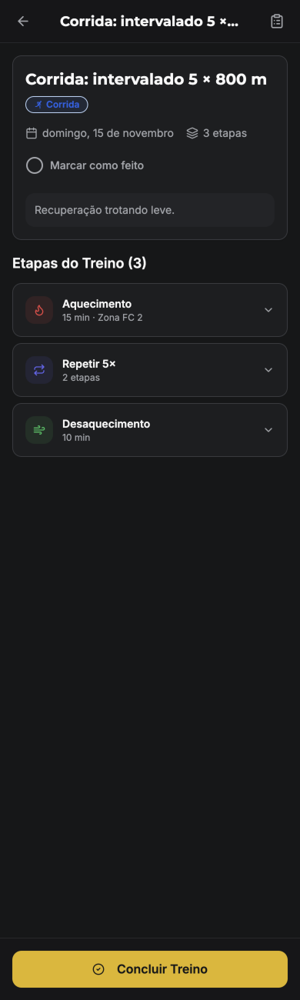
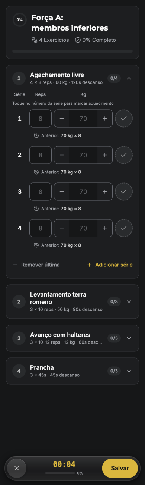
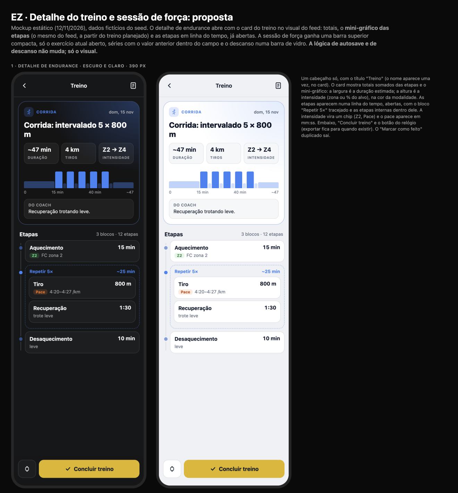
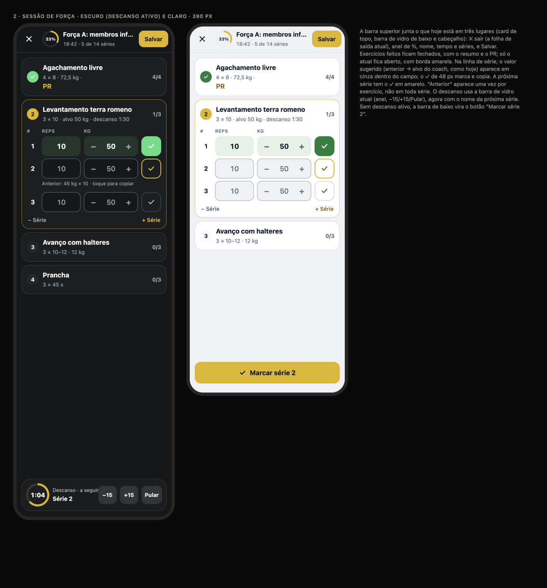

# Detalhe do treino e sessão de força: diagnóstico e proposta

**Data:** 12/11/2026 · **Quem:** EZ Design · **Base:** `main` 3976698 · **Guia:** `docs/design/design-system.md` · **Linguagem:** card de treino do feed (`docs/design/feed`), Home (`docs/design/home-athlete`)
**Mockup:** [`workout-mockup.html`](workout-mockup.html) · **Prévias:** [`img/`](img/)

Testado no emulador em 390 px, tema escuro, com a conta fictícia `bruno@ez.test`: detalhe de corrida (`demo-as-bruno-run-2`) e sessão de força (`demo-as-bruno-str-a3`).
- Nenhuma série foi marcada e nada foi salvo.
- Abrir a sessão criou um rascunho local (`strength-session:demo-as-bruno-str-a3`), que apaguei em seguida.

**Escopo:** só o visual. **A lógica de autosave, rascunho, descanso, wake lock e vibração não muda.**

## 1. Diagnóstico

| Detalhe de corrida | Sessão de força |
|---|---|
|  |  |

### Principais problemas
1. **O detalhe de endurance não mostra o treino.**
   - As etapas vêm recolhidas ("Repetir 5× · 2 etapas"), sem duração total, distância nem forma.
   - Para entender o treino, é preciso abrir etapa por etapa.
   - O feed já tem o mini-gráfico das etapas, e o detalhe, que é onde ele mais ajuda, não tem.
2. **Ações e títulos repetidos no detalhe.**
   - O nome aparece duas vezes (cabeçalho cortado e card).
   - "Marcar como feito" (círculo no card) e "Concluir treino" (barra de baixo) fazem a mesma coisa (`handleToggleComplete`, `WorkoutView.tsx:1150` e `:1287`).
3. **A sessão de força tem informação em três lugares:**
   - card de topo (anel de 0%, nome, "4 exercícios", "0% completo", barra);
   - barra de vidro de baixo (✕, tempo, %, Salvar);
   - o próprio exercício (0/4).
   O "%" aparece 3 vezes.
4. **As linhas de série são densas e repetitivas.**
   - "Anterior: 70 kg × 8" sob cada série (4 vezes iguais).
   - A dica "Toque no número da série para marcar aquecimento" sempre visível.
   - Os campos mostram o valor sugerido como placeholder fraco e não dá para saber qual é a próxima série.
   - "Remover última" fica com o mesmo peso de "Adicionar série".
5. **Ícones e cores fora do padrão.**
   - Etapas com ícones de chama, setas e vento em vermelho, roxo e verde, que não são a cor da modalidade.
   - Badge "Corrida" em azul preenchido.
   - Tempo total da sessão em fonte mono.

## 2. Proposta

### 2.1 Detalhe de endurance
- **Cabeçalho único:** ← · "Treino" · checklist. O nome aparece só no card.
- **Card do treino no visual do feed** (`--workout-card` + brilho `--sport-*`):
  - modalidade e data;
  - nome em `text-title-lg`;
  - **3 totais**: duração estimada, distância e intensidade;
  - **mini-gráfico das etapas**: a largura é a duração estimada de cada etapa, a altura é a intensidade (zona ou % do alvo, quando houver), na cor da modalidade, com as recuperações mais claras;
  - "Do coach" com as instruções.
- **Etapas em linha do tempo, abertas:**
  - cada etapa é um card com nome, duração à direita e o alvo como chip ("Z2", "Pace") + valor em mm:ss;
  - o bloco "Repetir 5×" fica tracejado, com a duração total do bloco e as etapas internas dentro.
- **Barra de baixo:** "Concluir treino" de 52 px + botão do relógio (exportar FIT/ZWO, que hoje não existe; o botão aparece só quando existir). **Sai** o "Marcar como feito" do card.
- **Dados:**
  - os totais somam só as etapas por tempo e por distância; se houver etapa por volta ou calorias, mostre só o que dá para somar;
  - a altura do gráfico usa a zona ou o alvo, quando existem; sem alvo, a altura é igual para todas;
  - o "Z2 → Z4" do mockup é exemplo: mostre a menor e a maior zona das etapas, ou omita.
  - **Nada novo.** Precisa do mesmo adaptador `vizModelFromWorkout(workout)` da tarefa HA-4 da Home.
- **Treino concluído:** o mesmo card com os números reais (o `WorkoutSummaryCard` do feed) e as séries/etapas feitas, como na Atividade (pendência 3.1 de 18/10).

### 2.2 Sessão de força (só visual)
- **Barra superior compacta**, que substitui o card de topo e a barra de vidro de baixo:
  - ✕ (abre a folha de saída atual);
  - anel de %;
  - nome do treino;
  - "18:42 · 5 de 14 séries" com `tabular-nums` em Inter (sai a fonte mono);
  - "Salvar".
- **Exercícios:**
  - os feitos ficam fechados, com ✓ verde, resumo e "PR" quando houver;
  - o atual fica aberto, com borda `primary/55` e número amarelo;
  - os próximos ficam fechados, com x/y.
  - O comportamento de abrir e fechar e a rolagem automática continuam iguais.
- **Linha de série** (`#`, Reps, Kg com −/+, ✓ de 48 px):
  - o valor sugerido (anterior → alvo, a mesma lógica de hoje) aparece em cinza dentro do campo;
  - a série feita ganha fundo `success/12` e o ✓ verde;
  - a **próxima série** tem o ✓ com borda amarela;
  - "Anterior: 45 kg × 10 · toque para copiar" aparece **uma vez**, abaixo da próxima série;
  - a dica do aquecimento vira um tooltip na primeira vez;
  - "− Série" fica em cinza e "+ Série" em `primary-ink`.
- **Descanso:** a barra de vidro atual (anel com o tempo, −15, +15, Pular), com "Descanso · a seguir: Série 2". Sem descanso ativo, a barra de baixo mostra **"Marcar série N"**, que chama o mesmo handler do ✓ da próxima série (opcional).

## 3. Backlog para o EZ Frontend (em ordem)

**⭐ = maior ganho em ~1 dia** (WS-1 a WS-3).

| ID | Tarefa | Tam. | Arquivos |
|---|---|---|---|
| ⭐ WS-1 | **Card do treino no detalhe de endurance:** totais + mini-gráfico (via `vizModelFromWorkout`, compartilhado com HA-4) + "Do coach"; cabeçalho único; tirar o "Marcar como feito" duplicado. | M | `src/pages/athlete/WorkoutView.tsx` (~l. 1060-1170, 1280-1320), `src/components/timeline/workout-viz/*` |
| ⭐ WS-2 | **Etapas em linha do tempo, abertas**, com chips de alvo, pace em mm:ss e bloco de repetição tracejado; ícones e cores das etapas na cor da modalidade. | M | `WorkoutView.tsx` (lista de etapas, `StageItem`/equivalente) |
| ⭐ WS-3 | **Sessão de força: barra superior compacta** que substitui o card de topo e a barra de vidro (mesmos handlers de sair e salvar); tempo em Inter `tabular-nums`. | P | `src/pages/athlete/StrengthWorkoutSession.tsx` (topo e barra de baixo) |
| WS-4 | **Linhas de série:** valor sugerido dentro do campo, próxima série destacada, "Anterior" uma vez por exercício, dica de aquecimento como tooltip, série feita com fundo de sucesso. | M | `StrengthWorkoutSession.tsx` (linha de série) |
| WS-5 | **Exercícios fechados com resumo e PR**; estilo do atual. | P | `StrengthWorkoutSession.tsx` (cabeçalho de exercício) |
| WS-6 | **Barra de descanso** com "a seguir: Série N" e, sem descanso, "Marcar série N" (mesmo handler). | P | `src/components/athlete/RestTimerPill.tsx`, `StrengthWorkoutSession.tsx` |
| WS-7 | Treino concluído no detalhe: card com números reais + o que foi feito (3.1). | M | `WorkoutView.tsx`, reaproveitando `ActivityDetail` |
| WS-8 | QA: autosave, recarregar no meio, descanso com tela bloqueada e saída continuam iguais (testes de regressão do EZ QA). Visual em 375/390 px, claro e escuro. | P | testes do EZ QA |

**Ordem:** WS-1 → WS-2 → WS-3 (≈ 1 dia) → WS-4 → WS-5 → WS-6 → WS-7 → WS-8.
